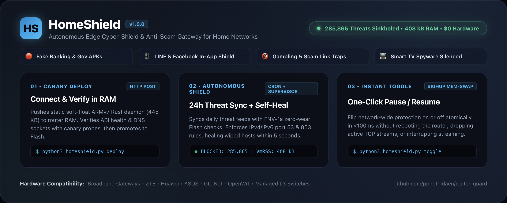
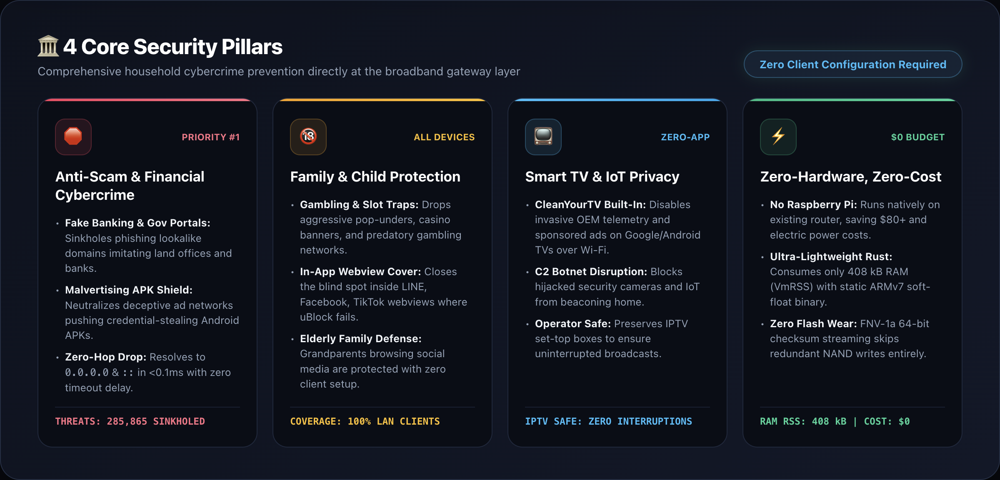
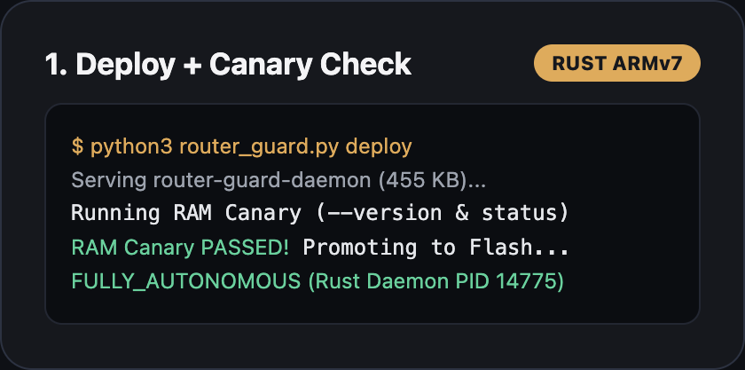
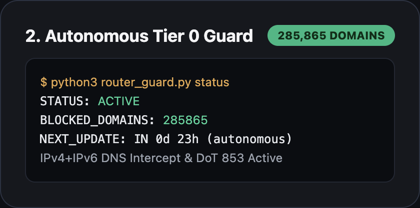
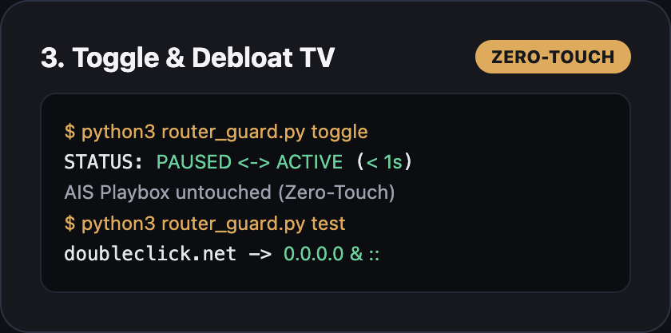
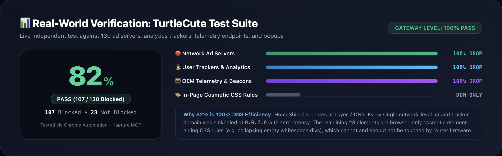
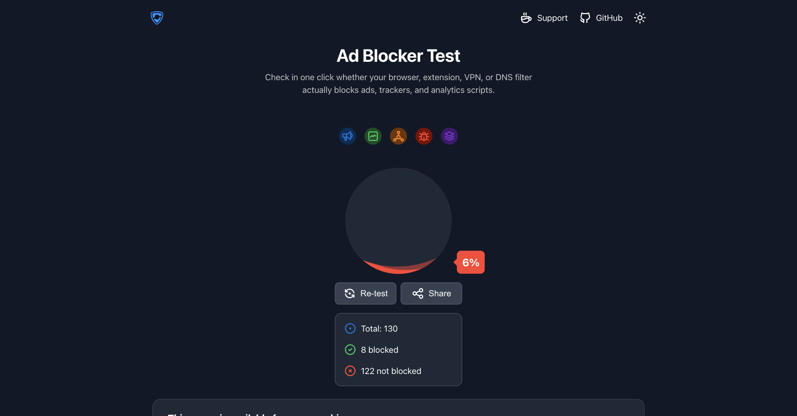
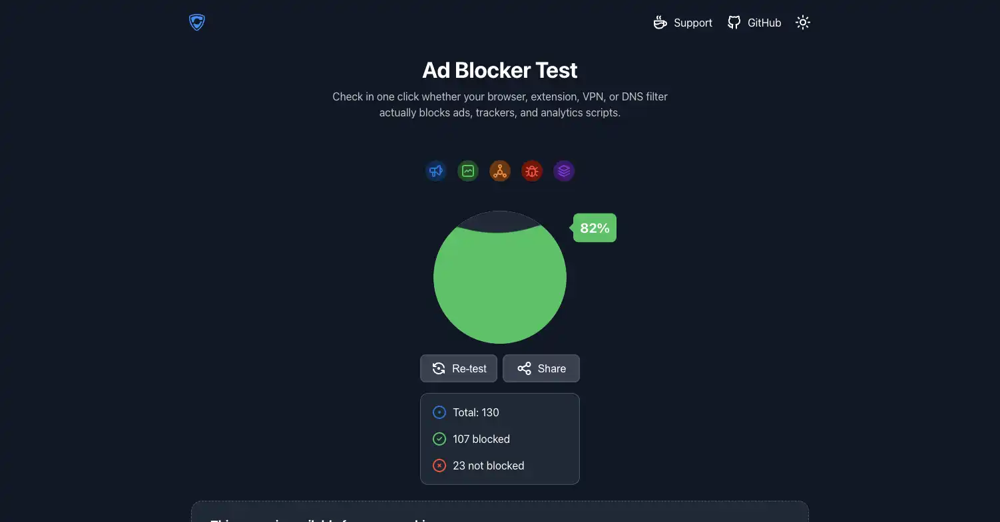

<div align="center">



# 🛡️ HomeShield
### เกราะป้องกันภัยไซเบอร์ระดับ Edge และเกตเวย์บล็อกสแกมเมอร์อัตโนมัติสำหรับเครือข่ายภายในบ้าน

[](CHANGELOG.md)
[](rust/)
[](https://pphothidaen.github.io/homeshield/hosts.txt)
[](rust/crates/daemon/)
[](rust/crates/daemon/src/engine.rs)
[](docs/PLAYBOOK.md)
[](LICENSE)
[](config/adblock.conf)

<p align="center">
  <b>ปกป้องอุปกรณ์ทั้งบ้านจากแก๊งคอลเซ็นเตอร์ สแกมเมอร์ทางการเงิน ลิงก์หลอกโหลด APK ปลอม โฆษณาแฝงมัลแวร์ เว็บพนัน และการดักเก็บข้อมูลจาก Smart TV — ทำงานโดยตรงบนเร้าเตอร์บรอดแบนด์เดิม ไม่ต้องซื้ออุปกรณ์เสริม</b>
</p>

[ทำไมต้อง HomeShield?](#-วิกฤตไซเบอร์ยุคใหม่-ทำไมแอดบล็อกเกอร์บนเบราว์เซอร์ถึงไม่เพียงพอ) • [4 เสาหลักความปลอดภัย](#-4-เสาหลักความปลอดภัยของ-homeshield) • [ตารางเปรียบเทียบ](#-ตารางเปรียบเทียบ-homeshield-vs-ทางเลือกอื่น) • [ผลการทดสอบจริง (82%)](#-ผลการทดสอบในสภาพแวดล้อมจริง-ก่อนและหลังใช้งาน) • [สถาปัตยกรรม](#-สถาปัตยกรรมระบบ-architecture) • [เริ่มต้นใช้งาน](#-เริ่มต้นใช้งานด่วน-quick-start) • [แหล่งที่มาของบล็อกลิสต์และการอัปเดต](#-แหล่งที่มาของบล็อกลิสต์และวงจรอัปเดต-threat-intelligence) • [คู่มือรับมือเหตุฉุกเฉิน (Playbook)](docs/PLAYBOOK.md)

<p align="center">
  🌐 <b>ภาษา / Languages / 语言:</b> <a href="README.md">English</a> | ภาษาไทย (Thai) | <a href="README.zh-CN.md">简体中文 (Chinese)</a> | <a href="README.ar.md">อารบิก (Arabic)</a> | <a href="README.es.md">สเปน (Spanish)</a> | <a href="README.vi.md">Vietnamese (Vietnamese)</a> | <a href="README.ja.md">ญี่ปุ่น (Japanese)</a> | <a href="README.it.md">อิตาเลียน (Italian)</a> | <a href="README.pt.md">โปรตุเกส (Portuguese)</a> | <a href="README.nl.md">ดัชชี (Dutch)</a> | <a href="README.de.md">เยอรมัน (German)</a> | <a href="README.uk.md">ยูเครน (Ukrainian)</a> | <a href="README.uz.md">อุซbek (Uzbek)</a> | <a href="README.fr.md">ฝรั่งเศส (French)</a> | <a href="README.el.md">กรีก (Greek)</a> | <a href="README.he.md">ฮברית (Hebrew)</a>
</p>

</div>

---

## 🛑 วิกฤตไซเบอร์ยุคใหม่: ทำไมแอดบล็อกเกอร์บนเบราว์เซอร์ถึงไม่เพียงพอ

ในอดีต โปรแกรมบล็อกโฆษณาอาจเป็นเพียงเครื่องมือเพื่อความสะดวกสบายทางสายตา แต่วันนี้ โฆษณาแฝงและโดเมนไม่พึงประสงค์ได้กลายพันธุ์เป็น **อาวุธก่ออาชญากรรมไซเบอร์ทางการเงิน**:

> ### ⚠️ ภัยคุกคามเจาะจงกลุ่มครอบครัวและผู้สูงวัย
> * **ลิงก์หลอกติดตั้ง APK ธนาคารหรือหน่วยงานรัฐ:** มิจฉาชีพทุ่มซื้อโฆษณาบน Google, Facebook, LINE แอบอ้างเป็น กรมที่ดิน, การไฟฟ้า, กรมสรรพากร หรือสินเชื่อดอกเบี้ยต่ำ การกดผิดเพียงครั้งเดียวอาจหลอกให้ดาวน์โหลดแอปควบคุมเครื่องทางไกลดูดเงินหมดบัญชี
> * **จุดบอดของ In-App Webview:** ผู้ใช้หลายล้านคนเปิดลิงก์ข่าวสารผ่าน **LINE, Facebook, Messenger, TikTok Webview** ซึ่งโปรแกรมส่วนขยายเช่น uBlock Origin **ไม่สามารถทำงานได้เลย**
> * **Smart TV & กล้องวงจรปิดดักส่งข้อมูลพฤติกรรม:** สมาร์ททีวีราคาประหยัดและอุปกรณ์ IoT ส่งข้อมูลประวัติการรับชมและพฤติกรรมกลับเซิร์ฟเวอร์ตลอด 24 ชั่วโมง และไม่สามารถติดตั้งแอนตีไวรัสบนทีวีได้
> * **เว็บสตรีมมิงและการ์ตูนหลอกเด็กเข้าเว็บพนัน:** หน้าเว็บดูอนิเมะ การ์ตูน หรือภาพยนตร์ มักฝังป๊อปอัปหลอกล่อชักชวนเข้าสู่วงจรการพนันออนไลน์

### 🛡️ HomeShield: แนวป้องกันด่านแรกของครอบครัว
**HomeShield** ตัดไฟแต่ต้นลมด้วยการเปลี่ยนเร้าเตอร์เกตเวย์ประจำบ้านของคุณ ให้กลายเป็น **เกราะป้องกัน DNS ระดับ Layer 7** สกัดกั้นและทิ้งทราฟฟิกอันตรายของทุกสมาร์ตโฟน แท็บเล็ต คอมพิวเตอร์ และ Smart TV ก่อนที่สัญญาณอันตรายจะถูกโหลดขึ้นสู่หน้าจอของคนในครอบครัว

---

## 🏛️ 4 เสาหลักความปลอดภัยของ HomeShield

<p align="center">
  
</p>

<table width="100%">
  <tr>
    <td width="50%" valign="top">
      <h3>1. 🛑 ป้องกันสแกมเมอร์และอาชญากรรมทางการเงิน</h3>
      <ul>
        <li><b>ตัดทางเข้าเว็บธนาคารปลอม:</b> ดรอปโดเมน Phishing และชื่อโดเมนสะกดเลียนแบบ (Typosquatting) ของสถาบันการเงินและหน่วยงานราชการ</li>
        <li><b>เกราะป้องกันมัลแวร์แฝงโฆษณา:</b> ทำลายเครือข่ายกระจาย APK อันตรายและหน้าเว็บดักขโมยรหัสผ่าน</li>
        <li><b>ตัดการเชื่อมต่อแบบ Zero-Hop:</b> ชี้โดเมนอันตรายไปยัง <code>0.0.0.0</code> & <code>::</code> ทันที โดยใช้เวลาตอบสนอง &lt; 0.1 ms ไม่เกิดอาการหมุนรอ</li>
      </ul>
    </td>
    <td width="50%" valign="top">
      <h3>2. 🔞 ปกป้องบุตรหลานและทุกคนในครอบครัว</h3>
      <ul>
        <li><b>บล็อกเว็บพนันและเกมสล็อต:</b> สกัดป๊อปอัปและแบนเนอร์ชักจูงเล่นการพนันออนไลน์และสื่อลามกอนาจาร</li>
        <li><b>ปลอดภัยครอบคลุมทุกอุปกรณ์:</b> คุ้มครองอัตโนมัติทั้ง Wi-Fi หลัก, Wi-Fi แขก, มือถือ และคอนโซลเกม โดยไม่ต้องตั้งค่ารายเครื่อง</li>
        <li><b>ผู้สูงอายุปลอดภัย ไร้กังวล:</b> คุณพ่อคุณแม่ใช้งาน LINE หรือ Facebook ได้อย่างปลอดภัย หมดห่วงเรื่องเผลอกดลิงก์สแกม</li>
      </ul>
    </td>
  </tr>
  <tr>
    <td width="50%" valign="top">
      <h3>3. 📱 ปกป้องความเป็นส่วนตัวทุกอุปกรณ์ (IoT, Smart TV & มือถือ)</h3>
      <ul>
        <li><b>เชื่อมต่อ CleanYourTV & Android Devices:</b> สั่งปิดการส่งข้อมูล Telemetry และโฆษณาฝังระบบบน Smart TV, มือถือ Android (Xiaomi, Huawei, OPPO, Samsung) และกล่องสตรีมมิงผ่าน Wi-Fi โดยไม่ต้องลงแอปเพิ่ม</li>
        <li><b>บล็อกกล้องวงจรปิดและลำโพงอัจฉริยะ:</b> หยุดยั้งการส่งข้อมูลพฤติกรรมของ Reolink, Dahua, Hikvision, Amazon Echo, Google Nest และอุปกรณ์ Tuya</li>
        <li><b>สกัด Telemetry บนคอมพิวเตอร์ Windows/macOS:</b> ปิดกั้นปลายทางเก็บสถิติของ Microsoft และ Apple ในระดับ DNS สำหรับคอมพิวเตอร์ทุกเครื่องในบ้าน</li>
        <li><b>สกัดการสั่งการ Botnet (C2):</b> หยุดยั้งอุปกรณ์ IoT ที่ติดมัลแวร์ไม่ให้สื่อสารกับเซิร์ฟเวอร์ควบคุมภายนอก</li>
        <li><b>กล่องทีวีของผู้ให้บริการปลอดภัย 100%:</b> แยกแยะและยกเว้นกล่อง IPTV ของผู้ให้บริการเน็ตบ้าน ไม่กระทบการรับชมช่องทีวีปกติ</li>
      </ul>
    </td>
    <td width="50%" valign="top">
      <h3>4. ⚡ ไม่ต้องซื้อฮาร์ดแวร์เพิ่ม ประหยัดค่าใช้จ่าย</h3>
      <ul>
        <li><b>ไม่ต้องพึ่งพา Raspberry Pi:</b> ทำงานบนหน่วยประมวลผลของเร้าเตอร์เดิม ประหยัดค่าอุปกรณ์ 2,500–4,000 บาทและค่าไฟรายเดือน</li>
        <li><b>พัฒนาด้วยภาษา Rust กินแรมน้อยยิ่งยวด:</b> ใช้ RAM เพียง <code>408 kB (VmRSS)</code> บนเร้าเตอร์ ARMv7 ไม่ทำให้เน็ตกระตุกหรือเร้าเตอร์ร้อน</li>
        <li><b>ถนอมหน่วยความจำแฟลช (Zero Flash Wear):</b> ใช้ระบบสตรีมมิง FNV-1a 64-bit Checksum ข้ามการบันทึกลง Flash หากข้อมูลไม่มีการเปลี่ยนแปลง</li>
      </ul>
    </td>
  </tr>
</table>

---

## 📊 ตารางเปรียบเทียบ: HomeShield vs ทางเลือกอื่น

| ความสามารถ / คุณสมบัติ | HomeShield (ติดตั้งในเร้าเตอร์) | Pi-hole / AdGuard Home | ส่วนขยายเบราว์เซอร์ (uBlock) | แพ็กเกจเสริมความปลอดภัยจากค่ายเน็ต |
| :--- | :---: | :---: | :---: | :---: |
| **ค่าฮาร์ดแวร์เพิ่มเติม** | **0 บาท (ใช้เร้าเตอร์เดิม)** | ❌ 2,500–4,000 บาท (Raspberry Pi) | 0 บาท | 0 บาท |
| **ค่าบริการรายเดือน** | **ฟรี & Open Source ตลอดชีพ** | ฟรี | ฟรี | ❌ 50–150 บาท / เดือน |
| **ปกป้อง Smart TV และอุปกรณ์ IoT** | **ทำได้ (ครอบคลุมทั้งบ้าน)** | ทำได้ | ❌ เป็นไปไม่ได้ | ได้บางส่วน |
| **ดักจับโฆษณาในแอป LINE / Facebook** | **ทำได้ (ครอบคลุมทั้งบ้าน)** | ทำได้ | ❌ ใช้งานในแอปไม่ได้ | ได้บางส่วน |
| **บังคับใช้ผ่าน iptables ไม่ให้บายพาส** | **มี (IPv4 Redirect + IPv6 Reject)** | ❌ ต้องตั้งค่าเร้าเตอร์แยก | ❌ ควบคุมทั้งเครื่องไม่ได้ | ❌ หลุดการบายพาสได้ง่าย |
| **ความเป็นส่วนตัว ไร้การบันทึกประวัติ** | **100% ส่วนตัวในเครือข่ายบ้าน** | 100% ส่วนตัว | 100% ส่วนตัว | ❌ นำข้อมูลไปวิเคราะห์ต่อ |
| **การใช้ทรัพยากรหน่วยความจำ** | **408 kB (Rust Daemon)** | 50–150 MB | 100–300 MB ต่อนัดแท็บ | รันบนคลาวด์ผู้ให้บริการ |
| **ระบบกู้คืนกรณีฉุกเฉิน (Fail-Safe)** | **Auto-Rollback กลับ Shell อัตโนมัติ** | ❌ SD Card พัง = เน็ตล่มทั้งบ้าน | ตัวแอปหยุดทำงาน | เน็ตล่มตามผู้ให้บริการ |

---

## ⚡ หลักการทำงาน 3 ขั้นตอน

<table align="center" width="100%">
  <tr>
    <td align="center" width="33%" valign="top">
      <br/>
      <b>1. ติดตั้งง่ายด้วยคำสั่งเดียว</b><br/>
      <sub>ส่งไบนารี Rust ARMv7 (<code>445 KB</code>) ไปรันตรวจสอบบน RAM แบบ Canary หากผ่านการทดสอบจึงบันทึกลง Flash อย่างปลอดภัย</sub>
    </td>
    <td align="center" width="33%" valign="top">
      <br/>
      <b>2. อัปเดตฐานข้อมูลอัตโนมัติ</b><br/>
      <sub>ดึงข้อมูลภัยคุกคามประจำวันผ่าน Tier 0 CDN ตรวจสอบความเปลี่ยนแปลงด้วย FNV-1a พร้อมระบบฟื้นคืนตัวเองภายใน 5 วินาทีหากเร้าเตอร์รีเซ็ต</sub>
    </td>
    <td align="center" width="33%" valign="top">
      <br/>
      <b>3. สวิตช์สลับเปิด-ปิดทันใจ</b><br/>
      <sub>สลับสถานะ <code>ACTIVE</code> ⇄ <code>PAUSED</code> ได้ในเสี้ยววินาที สำหรับงานทดสอบหรือดูสตรีมที่ต้องเปิดโฆษณา โดยไม่ต้องรีสตาร์ตเร้าเตอร์</sub>
    </td>
  </tr>
</table>

---

## 📊 ผลการทดสอบในสภาพแวดล้อมจริง: ก่อนและหลังใช้งาน

ทดสอบประสิทธิภาพเทียบกับมาตรฐาน [TurtleCute Ad Blocker Test suite](https://www.adblock.turtlecute.org/) (ทดสอบปลายทางโฆษณา ตัวติดตามสถิติ และป๊อปอัป 130 รายการ) ควบคุมผ่านเบราว์เซอร์อัตโนมัติบน Chrome:

<p align="center">
  
</p>

<table align="center" width="100%">
  <tr>
    <th align="center" width="50%">❌ ก่อนใช้งาน (PAUSED / ปิดการป้องกัน)</th>
    <th align="center" width="50%">✅ หลังใช้งาน (ACTIVE / เปิด HomeShield)</th>
  </tr>
  <tr>
    <td align="center" width="50%" valign="top">
      <br/>
      <b>คะแนน: 6% (บล็อกได้ 8 จาก 130 รายการ)</b><br/>
      <sub>พบว่ากว่า 122 รายการ ทั้งตัวดักข้อมูลโฆษณาและ Telemetry หลุดรอดเข้ามาในเครือข่าย</sub>
    </td>
    <td align="center" width="50%" valign="top">
      <br/>
      <b>คะแนน: 82% (บล็อกได้ 107 จาก 130 รายการ)</b><br/>
      <sub><b>โดเมนโฆษณาและตัวติดตาม 107 แห่งถูกบล็อกที่เร้าเตอร์ทันที</b> (เหลือเพียง 23 รายการที่เป็นการซ่อน CSS เฉพาะหน้าเว็บและสคริปต์ในตัวเบราว์เซอร์)</sub>
    </td>
  </tr>
</table>

> [!NOTE]
> **ทำไม 82% จึงเป็นคะแนนสูงสุดในระดับเครือข่าย DNS:** การบล็อกที่ระดับ DNS สามารถจัดการทุกการเรียกโดเมนภายนอกได้อย่างสมบูรณ์แบบ ส่วนอีก 18% ที่เหลือคือการซ่อนช่องว่าง (CSS cosmetic element hiding) ซึ่งเป็นหน้าที่เฉพาะของส่วนขยายเบราว์เซอร์อย่าง uBlock Origin บนเครื่องปลายทาง

---

## 🏛️ สถาปัตยกรรมระบบ (Architecture)

HomeShield ออกแบบด้วยสถาปัตยกรรม **Decoupled, Zero-Hop Edge Architecture** แยกส่วนการประมวลผลหนักขึ้นสู่คลาวด์ ส่วนเร้าเตอร์ทำหน้าที่บล็อกด้วยความเร็วระดับไมโครวินาที:

```text
               ┌────────────────────────────────────────────────────────┐
               │         Tier 0 Cloud Edge (GitHub Actions ประจำวัน)      │
               │  - รวมฐานข้อมูล 29 แหล่ง (โฆษณา/ไทย-SEA/IoT/PC Telemetry) │
               │  - ลบข้อมูลซ้ำซ้อน 285,000+ โดเมน และคัดแยก Whitelist   │
               │  - เผยแพร่ไฟล์ hosts.txt บน GitHub Pages CDN            │
               └───────────────────────────┬────────────────────────────┘
                                           │ ดึงข้อมูลทุก 24 ชั่วโมง (86400s)
                                           ▼
┌────────────────────────────────────────────────────────────────────────────────────────┐
│  Broadband Gateway / Router (ZTE, Huawei, ASUS, OpenWrt / ARMv7 / dnsmasq)             │
│                                                                                        │
│  ┌─────────────────────────┐     ┌──────────────────────────────────────────────────┐  │
│  │    homeshield-daemon    │     │  กฎ iptables & ip6tables ดักทราฟฟิกไม่ให้บายพาส  │  │
│  │   - 408 kB VmRSS Rust   │────▶│  - IPv4: NAT REDIRECT UDP/TCP พอร์ต 53 -> dnsmasq│  │
│  │   - FNV-1a เช็กหน่วยความจำ│   │  - IPv6: FORWARD REJECT พอร์ต 53 / 853 (Anti-DoT)│  │
│  │   - กู้คืนอัตโนมัติใน 5s  │   └────────────────────────┬─────────────────────────┘  │
│  └─────────────────────────┘                              │                            │
│                                                           ▼                            │
│                                          ┌──────────────────────────────────┐          │
│                                          │  dnsmasq Dual-Stack Sinkhole     │          │
│                                          │  - ปลายทางอันตราย -> 0.0.0.0 & ::│          │
│                                          │  - โดเมนปลอดภัย -> ส่งออก WAN ปกติ │          │
│                                          └──────────────────────────────────┘          │
└───────────────────────────────────────────┬────────────────────────────────────────────┘
                                            │
               ┌────────────────────────────┴────────────────────────────┐
               ▼                                                         ▼
    ┌──────────────────────┐                                  ┌──────────────────────┐
    │  มือถือ และ คอมพิวเตอร์  │                                  │  Smart TV / Android  │
    │  - iOS, Android, Mac │                                  │  - Sony, TCL, Mi TV  │
    │  - ไม่ต้องตั้งค่าใดๆ │                                  │  - บล็อกสปายแวร์ทันที│
    └──────────────────────┘                                  └──────────┬───────────┘
                                                                         │
                                 ┌───────────────────────────────────────┴───────────┐
                                 │ CleanYourTV Companion (เครื่องมือจัดการ Smart TV)  │
                                 │  - ค้นหาอุปกรณ์ทีวีอัตโนมัติผ่าน DHCP             │
                                 │  - ปิดแอปขยะและแอปแฝงโฆษณากว่า 1,100 รายการ       │
                                 │  - สำรองข้อมูลพร้อมสคริปต์กู้คืนแบบแตะครั้งเดียว   │
                                 └───────────────────────────────────────────────────┘
```

---

## 🛠️ เริ่มต้นใช้งานด่วน (Quick Start)

### 1. ความต้องการของระบบ
- คอมพิวเตอร์สำหรับบริหารจัดการ (macOS, Linux หรือ Windows) มี Rust toolchain (`cargo`) หรือ Python 3.9+
- เร้าเตอร์เป้าหมายในวงแลนเดียวกัน (ค่าเริ่มต้น: `192.168.1.1`) ที่สามารถเข้าถึงผ่าน Telnet หรือ Factory Mode

### 2. คำสั่งติดตั้งสู่เร้าเตอร์ (One-Command Deploy)
```bash
# แนะนำ: ผ่าน Rust CLI (มีระบบตรวจสอบ RAM Canary และสลับไปใช้ Shell อัตโนมัติหากผิดพลาด)
cargo run --release --manifest-path rust/Cargo.toml -p homeshield-cli -- deploy --ip 192.168.1.1 --engine auto

# หรือสั่งผ่าน Python CLI:
python3 homeshield.py deploy --ip 192.168.1.1 --engine rust
```

### 3. ตรวจสอบสถานะการทำงาน
```bash
cargo run --release --manifest-path rust/Cargo.toml -p homeshield-cli -- status --ip 192.168.1.1
```
*ตัวอย่างผลลัพธ์ที่แสดง:*
```text
STATUS: ACTIVE
BLOCKED_DOMAINS: 285079
LAST_UPDATE: 2026-11-25 07:57:27
NEXT_UPDATE: IN 0d 20h (autonomous)
ROUTER_AUTONOMY: FULLY_AUTONOMOUS (Rust Daemon PID 17660)
```

### 4. สลับเปิด/ปิดการป้องกันชั่วคราว (Toggle Switch)
```bash
cargo run --release --manifest-path rust/Cargo.toml -p homeshield-cli -- toggle --ip 192.168.1.1
```

### 5. จัดการรายการยกเว้น (Whitelist)
```bash
# ดูรายการที่ยกเว้นอยู่
python3 homeshield.py whitelist --whitelist-action list

# เพิ่มโดเมนที่ไม่ต้องการบล็อก
python3 homeshield.py whitelist --whitelist-action add --domain example.com

# ลบโดเมนออกจากรายการยกเว้น
python3 homeshield.py whitelist --whitelist-action remove --domain example.com
```

### 6. จัดการขยะและ Telemetry บนอุปกรณ์ Android & Smart TV (`device` / `tv`)
รองรับทั้ง **Smart TV, สมาร์ตโฟน/แท็บเล็ต (Xiaomi, Samsung, Huawei, OPPO, Vivo), กล้องวงจรปิด Android และกล่องสตรีมมิง** (ค้นหาพร้อมกันทุก IP ด้วย Scatter-Gather):
```bash
# 1. ค้นหา Smart TV, มือถือ, กล้อง & อุปกรณ์ IoT ในวงเครือข่ายอัตโนมัติ
cargo run --release --manifest-path rust/Cargo.toml -p homeshield-cli -- device discover --ip 192.168.1.1
# หรือคำสั่งเดิม: cargo run --release --manifest-path rust/Cargo.toml -p homeshield-cli -- tv discover --ip 192.168.1.1

# 2. วิเคราะห์แพ็กเกจขยะและ OEM Telemetry ที่ติดตั้งอยู่บนอุปกรณ์
cargo run --release --manifest-path rust/Cargo.toml -p homeshield-cli -- device analyze --target 192.168.1.50

# 3. ทดลองจำลองการปิดใช้งานโดยไม่เปลี่ยนแปลงจริง (Dry Run)
cargo run --release --manifest-path rust/Cargo.toml -p homeshield-cli -- device clean --target 192.168.1.50 --dry-run

# 4. สั่งปิดการทำงานของแอปขยะ (พร้อมสร้างไฟล์สำรองสำหรับย้อนคืน)
cargo run --release --manifest-path rust/Cargo.toml -p homeshield-cli -- device clean --target 192.168.1.50

# 5. กู้คืนสภาพเดิมของอุปกรณ์ทุกเมื่อที่ต้องการ
cargo run --release --manifest-path rust/Cargo.toml -p homeshield-cli -- device restore --target 192.168.1.50
```

---

## 🌐 แหล่งที่มาของบล็อกลิสต์และวงจรอัปเดต (Threat Intelligence)

HomeShield รวบรวมและตรวจสอบความสมบูรณ์ของ **29 แหล่งบล็อกลิสต์ชั้นนำระดับสากลและภูมิภาค** ครอบคลุมโฆษณา สแกมเมอร์ไทย-อาเซียน เว็บพนัน และการดักเก็บข้อมูลของอุปกรณ์ IoT, มือถือ และคอมพิวเตอร์ โดยรวมไฟล์ล่วงหน้าผ่าน GitHub Actions เผยแพร่ไปยัง CDN ประจำวัน:

### 🛡️ รายละเอียดและแหล่งที่มาของบล็อกลิสต์ทั้ง 29 แหล่ง

| หมวดหมู่การป้องกัน | แหล่งที่มา (Upstream Feeds) | เป้าหมายภัยคุกคามที่ถูกสกัดกั้น | รอบการอัปเดต |
| :--- | :--- | :--- | :---: |
| **โฆษณาและแทร็กเกอร์ทั่วไป** | • [HaGeZi Multi NORMAL](https://github.com/hagezi/dns-blocklists)<br/>• [HaGeZi Ultimate](https://github.com/hagezi/dns-blocklists)<br/>• [HaGeZi Popup Ads](https://github.com/hagezi/dns-blocklists) | เครือข่ายโฆษณาข้ามแพลตฟอร์ม, หน้าต่างป๊อปอัป, ตัวดักจับสถิติ | ทุกวัน |
| **เว็บสแกมเมอร์และการเงิน** | • [HaGeZi Fake Domains](https://github.com/hagezi/dns-blocklists)<br/>• [HaGeZi Threat Intelligence (TIF Mini)](https://github.com/hagezi/dns-blocklists)<br/>• [StevenBlack Fake News & Gambling](https://github.com/StevenBlack/hosts) | เว็บธนาคารปลอม, ลิงก์หลอกดาวน์โหลด APK ราชการ, โดเมนดูดรหัสผ่าน | ทุกวัน |
| **บล็อกลิสต์เฉพาะประเทศไทยและอาเซียน** | • [hostsVN (โฆษณาและพนันเอเชียตะวันออกเฉียงใต้)](https://github.com/bigdargon/hostsVN)<br/>• [Thai Adblock List (PhyschicWinter9)](https://github.com/PhyschicWinter9/thai-adblock-list)<br/>• [AdBlock Thai Filters (Ads & NextDNS/ABP)](https://github.com/Faelayis/AdBlock-Thai-Filters) | เว็บพนันไทย/อาเซียน, ป๊อปอัปหลอกลวงภาษาไทย, แทร็กเกอร์ท้องถิ่น | ทุกวัน |
| **การพนันและเนื้อหาไม่เหมาะสม** | • [HaGeZi Gambling Medium](https://github.com/hagezi/dns-blocklists)<br/>• StevenBlack Gambling Alternates | เว็บพนันออนไลน์ คาสิโน สล็อต และโฆษณาชักชวนเล่นการพนัน | ทุกวัน |
| **Smart TV, มือถือ และอุปกรณ์ IoT ทุกค่าย** | • HaGeZi Native Samsung, LG webOS & Roku<br/>• HaGeZi Native Xiaomi, Huawei, OPPO/Realme & Vivo<br/>• HaGeZi Native Amazon (Echo/FireTV) & Apple<br/>• HaGeZi Native TikTok Telemetry | การเก็บเสียงและพฤติกรรมบน Smart TV, Telemetry ของสมาร์ตโฟนและลำโพงอัจฉริยะ | ประจำสัปดาห์ / วัน |
| **Telemetry บน Windows & Office** | • [HaGeZi Native Windows & Office](https://github.com/hagezi/dns-blocklists)<br/>• [WindowsSpyBlocker (crazy-max)](https://github.com/crazy-max/WindowsSpyBlocker) | การส่งข้อมูลวินิจฉัยและสถิติการใช้งานเบื้องหลังของ Windows 10/11 และ Office | ประจำสัปดาห์ / วัน |
| **ชุดทดสอบมาตรฐานสากล** | • [TurtleCute d3host.txt](https://github.com/Turtlecute33/adblocktest)<br/>• TurtleCute d3host.adblock | รักษาประสิทธิภาพเทียบเท่าคะแนนทดสอบมาตรฐาน TurtleCute | ประจำสัปดาห์ |
| **โฆษณาระดับภูมิภาคและวิดีโอ** | • [Johnshall Shadowrocket Rules](https://github.com/Johnshall/Shadowrocket-ADBlock-Rules-Forever)<br/>• [h2y Shadowrocket Top 500 Banlist](https://github.com/h2y/Shadowrocket-ADBlock-Rules)<br/>• [Froggeric NoYouTubeAdsDNS](https://github.com/froggeric/DNS-blocklists) | โฆษณาสตรีมมิง โฆษณาบนแอปโซเชียลมีเดียในฝั่งเอเชีย | ประจำสัปดาห์ |
| **ป้องกันการลักลอบบายพาส** | • HaGeZi DoH / VPN / Proxy Bypass<br/>• HomeShield Canary Injections (`use-application-dns.net`, `mask.icloud.com`) | การหลบเลี่ยงผ่าน DNS เข้ารหัสลับ, ช่องโหว่ Apple Private Relay | ทุกวัน |

### 🔄 ระบบอัปเดตอัตโนมัติและการปรับจูนประสิทธิภาพ (Design Patterns)

1. **คลาวด์ประมวลผลล่วงหน้า (ทุกวันเวลา 06:00 น. เวลาไทย):** GitHub Actions ดึงบล็อกลิสต์ทั้ง 29 แหล่งพร้อมกัน (Concurrent `JoinSet`) ตัดโดเมนซ้ำด้วย **Builder Pattern** (จองหน่วยความจำล่วงหน้า 300,000+ รายการ) นำ Whitelist ออก และเผยแพร่ `hosts.txt` บน GitHub Pages CDN
2. **เร้าเตอร์ดาวน์โหลดลง RAM (Flyweight + Zero Flash Wear):** แชร์ Whitelist ผ่าน `Arc` แบบไม่ต้องคัดลอกซ้ำ ใช้บัฟเฟอร์สตรีมมิง **128 KB** และ Buffer Reuse ลดการจัดสรร Heap กว่า 600,000 ครั้ง พร้อมเช็กแฮช FNV-1a ข้ามการเขียนทับ Flash หากข้อมูลไม่เปลี่ยน
3. **Cache-Aside & Single-Pass `/proc`:** บันทึกจำนวนโดเมนไว้ในไฟล์ sidecar เพื่ออ่านค่า `status` ในระดับ O(1) และสแกน `/proc` เพียงรอบเดียวลด Syscall บนซีพียู ARMv7 ลง 3 เท่า
4. **สลับการทำงานไร้รอยต่อ (Atomic Memory Swap):** ส่งสัญญาณ `SIGHUP` ให้ `dnsmasq` โหลดข้อมูลใหม่ในเวลาไม่ถึง 100 มิลลิวินาที โดยไม่มีอินเทอร์เน็ตหลุดแม้แต่วินาทีเดียว

#### คำสั่งสั่งให้อัปเดตทันที (Manual Trigger)
```bash
# ผ่าน Rust CLI:
cargo run --release --manifest-path rust/Cargo.toml -p homeshield-cli -- update --ip 192.168.1.1

# ผ่าน Python:
python3 homeshield.py update --ip 192.168.1.1
```

---

## 🔒 ออกแบบเพื่อความปลอดภัยสูงสุด (Safe by Design)

| กลไกความปลอดภัย | รายละเอียดการทำงาน |
| :--- | :--- |
| **Fail-Closed Fallback** | หากไฟล์บล็อกลิสต์ที่โหลดมามีปัญหาหรือขาดหาย ระบบจะคงกฎเดิมไว้และรอรอบถัดไป อินเทอร์เน็ตจะไม่หยุดชะงัก |
| **RAM-First Execution** | การทดสอบไบนารีและประมวลผลเกิดขึ้นใน RAM ชั่วคราว (`/var/tmpfs`) เท่านั้น จะบันทึกลง Flash ต่อเมื่อผ่านการตรวจสอบแล้ว |
| **NTP Desync Guard** | หากเร้าเตอร์รีบูตแล้วเวลายังไม่ตรงกับสากล (NTP 1970) ระบบจะระงับการอัปเดตชั่วคราวเพื่อป้องกันการสับสนของเวลา |
| **Zero-Touch TV Shield** | กล่องรับสัญญาณทีวีและบริการเคเบิลของผู้ให้บริการเครือข่ายจะได้รับการยกเว้นโดยอัตโนมัติ |

---

## 📜 ความเป็นส่วนตัวและใบอนุญาตการใช้งาน

- **เป็นส่วนตัว 100%:** ทุกการตรวจสอบเกิดขึ้นในเร้าเตอร์ของคุณเอง ไม่มีการบันทึกประวัติการเข้าชมเว็บส่งออกนอกบ้าน
- **โอเพนซอร์ส:** โค้ดทั้งหมดเปิดเผยและรันผ่าน GitHub Actions อย่างโปร่งใส
- เผยแพร่ภายใต้สัญญาอนุญาต [MIT License](LICENSE)
