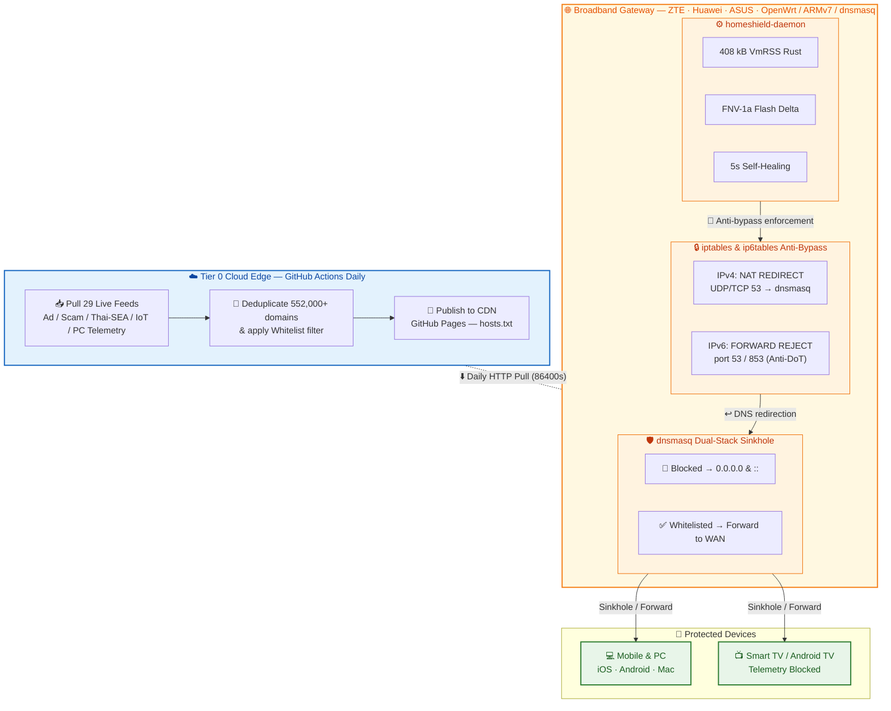

<! ---
Vietnamese translation of HomeShield README (machine-translated).
--->

 

# 🛡️ HomeShield
### Autonomous Edge Cyber-Shield & Anti-Scam Gateway for Home Networks

  <b>Bảo vệ toàn nhà trước các nhà tài chính lừa đảo, APK giả mạo vay tiền, quảng cáo ngầm, bẫy cờ bạc và phần mềm gián điệp Smart TV — chạy trực tiếp trên router broadband chuẩn mà không cần phần cứng bổ sung.</b>

[Why HomeShield?](#why-homeshield) • [4 Security Pillars](#4-core-security-pillars) • [Comparison](#the-ultimate-comparison-homeshield-vs-alternatives) • [Before & After (97%)](#real-world-verification-before--after) • [Architecture](#architecture) • [Quick Start](#quick-start) • [Blocklist Sources & Updates](#threat-intelligence-sources--update-lifecycle) • [Playbook & Rollback](docs/PLAYBOOK.md)

  🌐 <b>Languages / Ngôn ngữ:</b> English | <a href="README.md">English</a> | Tiếng Việt (Vietnamese) | <a href="README.ja.md">日本語 (Japanese)</a> | <a href="README.it.md">Italiano (Italian)</a> | <a href="README.pt.md">Português (Portuguese)</a> | <a href="README.nl.md">Nederlands (Dutch)</a> | <a href="README.de.md">Deutsch (German)</a> | <a href="README.uk.md">Українська (Ukrainian)</a> | <a href="README.uz.md">Özbekcha (Uzbek)</a> | <a href="README.fr.md">Français (French)</a> | <a href="README.el.md">Ελληνικά (Greek)</a> | <a href="README.he.md">עברית (Hebrew)</a> | <a href="README.es.md">Español (Spanish)</a> | <a href="README.ar.md">العربية (Arabic)</a>

---

## 🏛️ Kiến trúc

HomeShield sử dụng **kiến trúc Zero-Hop Edge tách rời** — router xử lý việc chặn DNS trên toàn mạng.

➡️ Tài liệu đầy đủ: [README.md](README.md)

