<div align="center">


# 🛡️ HomeShield
### 家庭网络边缘自主防诈骗网关与 DNS 网络盾

[](CHANGELOG.md)
[](rust/)
[](https://pphothidaen.github.io/homeshield/hosts.txt)
[](rust/crates/daemon/)
[](rust/crates/daemon/src/engine.rs)
[](docs/PLAYBOOK.md)
[](LICENSE)
[](config/adblock.conf)

<p align="center">
  <b>全网拦截电信诈骗、虚假贷款诱导下载、恶意广告劫持、网络赌博陷阱及智能电视/IoT隐私回传 —— 直接运行在光猫与宽带路由器中，无需额外购置硬件。</b>
</p>

[为什么选择 HomeShield？](#-现代网络犯罪危机为什么浏览器插件无法防范) • [四大核心防护支柱](#-4-大核心安全支柱) • [对比方案](#-全面对比-homeshield-vs-其他方案) • [实测效果 (97%)](#-实测效果前后对比-97-拦截率) • [系统架构](#-系统架构) • [快速开始](#-快速开始) • [规则来源与更新机制](#-威胁情报源与自动更新机制) • [应急回滚手册](docs/PLAYBOOK.md)

<p align="center">
  🌐 <b>语言 / Languages:</b> <a href="README.md">English</a> | <a href="README.th.md">ภาษาไทย</a> | 简体中文 (Chinese) | <a href="README.ar.md">العربية</a> | <a href="README.es.md">Spanish</a> | <a href="README.vi.md">Tiếng Việt</a> | <a href="README.ja.md">日本語</a> | <a href="README.it.md">Italiano</a> | <a href="README.pt.md">Português</a> | <a href="README.nl.md">Nederlands</a> | <a href="README.de.md">Deutsch</a> | <a href="README.uk.md">Українська</a> | <a href="README.uz.md">Oʻzbekcha</a> | <a href="README.fr.md">Français</a> | <a href="README.el.md">Ελληνικά</a> | <a href="README.he.md">עברית</a>
</p>

</div>

---

## 🛑 现代网络犯罪危机：为什么浏览器插件无法防范？

过去，广告拦截器仅仅是为了视觉清爽。今天，恶意广告与欺诈域名已演化为**高危害的金融网络犯罪武器**：

> ### ⚠️ 针对家庭与老年人的严峻威胁
> * **冒充官方机构与银行的钓鱼 APK：** 不法分子在社交媒体与低门槛广告联盟投放假冒电网、公积金、税务局或低息借贷的推广，诱导老人单次误触即下载具备远程操控能力的木马 APK。
> * **应用内内置浏览器（Webview）的监控盲区：** 微信、微信读书、LINE、抖音或快手内打开的链接，浏览器扩展（如 uBlock Origin）**完全无法加载与生效**。
> * **智能电视与智能家居的持续遥测监听：** 低价智能电视与联网摄像头每时每刻都在向云端上传用户行为与设备数据，甚至存在被控制成为僵尸网络的风险，且用户无法在电视中安装防病毒软件。
> * **面向儿童的博彩与赌博广告陷阱：** 动漫、游戏或影视盗版解析网站充斥大量诱导性下注弹窗，危害未成年人身心健康。

### 🛡️ HomeShield：家庭的第一道硬核防线
**HomeShield** 从根源解决危机，将原本闲置的家用光猫与路由器改造为**不可绕过的 Layer 7 DNS 智能安全网关**，在恶意数据包到达家庭手机、平板、电脑和智能电视的屏幕前将其彻底阻断。

---

## 🏛️ 4 大核心安全支柱

<p align="center">
  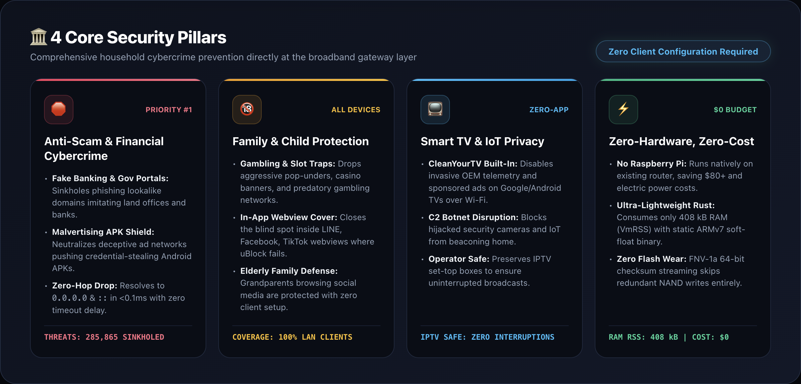
</p>

<table width="100%">
  <tr>
    <td width="50%" valign="top">
      <h3>1. 🛑 反诈骗与金融网络犯罪防御</h3>
      <ul>
        <li><b>假冒金融与政务拦截：</b> 阻断高仿钓鱼网站与李鬼域名（Typosquatting），保护家庭财产。</li>
        <li><b>恶意广告分发阻断：</b> 摧毁分发恶意 APK 与木马凭证窃取脚本的地下推广网络。</li>
        <li><b>零跳数丢弃 (Zero-Hop)：</b> 将黑名单解析直连 <code>0.0.0.0</code> 和 <code>::</code>，拦截时延 &lt; 0.1 ms，无任何网络卡顿。</li>
      </ul>
    </td>
    <td width="50%" valign="top">
      <h3>2. 🔞 家庭与未成年人健康守护</h3>
      <ul>
        <li><b>博彩与赌博弹窗阻截：</b> 全面屏蔽棋牌、电子老虎机、非法赌场等诱导性弹窗广告。</li>
        <li><b>全家设备无感守护：</b> 自动作用于主 Wi-Fi、访客 Wi-Fi 及游戏主机，无需逐一设置客户端。</li>
        <li><b>长辈安全放心使用：</b> 父母在聊天软件中点击链接亦受到底层防护，远离误触风险。</li>
      </ul>
    </td>
  </tr>
  <tr>
    <td width="50%" valign="top">
      <h3>3. 📱 全设备 IoT 与终端隐私保护盾 (电视/手机/摄像头/PC)</h3>
      <ul>
        <li><b>CleanYourTV 与泛安卓设备集成：</b> 通过局域网 ADB 禁用智能电视及安卓手机（小米、华为、OPPO、三星等）内置推广与遥测模块，无需安装客户端 App。</li>
        <li><b>摄像头与智能音箱遥测阻断：</b> 全面拦截 Reolink、大华、海康威视、Amazon Echo、Google Nest 及涂鸦等物联网设备的数据回传。</li>
        <li><b>Windows / macOS 系统遥测屏蔽：</b> 在网关 DNS 层直接拦截微软与苹果系统遥测上传端点，覆盖局域网内所有电脑设备。</li>
        <li><b>C2 僵尸网络阻断：</b> 封堵被入侵智能摄像头与物联网设备向境外控制服务器发送心跳。</li>
        <li><b>运营商 IPTV 零误杀：</b> 智能识别并豁免运营商机顶盒与直播流，绝不影响日常电视收看。</li>
      </ul>
    </td>
    <td width="50%" valign="top">
      <h3>4. ⚡ 零额外硬件、零成本运行</h3>
      <ul>
        <li><b>无需购买树莓派：</b> 直接运行在运营商光猫或现有路由器上，节省数百元硬件与电费。</li>
        <li><b>极轻量级 Rust 引擎：</b> 双核 ARMv7 路由器仅占用 <code>408 kB RAM (VmRSS)</code>，CPU 占用趋近于零。</li>
        <li><b>Flash 零磨损保障 (Zero-Wear)：</b> 运用流式 FNV-1a 64-bit 校验，规则未变更时完全跳过 Flash 写入。</li>
      </ul>
    </td>
  </tr>
</table>

---

## 📊 全面对比：HomeShield vs 其他方案

| 核心特性 | HomeShield (光猫/网关) | Pi-hole / AdGuard Home | 浏览器扩展 (uBlock) | 运营商“防诈安全包”增值业务 |
| :--- | :---: | :---: | :---: | :---: |
| **额外硬件采购成本** | **¥0 (现有路由器)** | ❌ ¥300–¥600 (树莓派/迷你主机) | ¥0 | ¥0 |
| **按月持续订阅费用** | **永久免费开源** | 免费 | 免费 | ❌ ¥10–¥30 / 月 |
| **覆盖智能电视与 IoT** | **是 (全屋覆盖)** | 是 | ❌ 无法覆盖 | 部分 |
| **覆盖聊天 App 内置浏览器** | **是 (全网阻断)** | 是 | ❌ 无法在 App 内生效 | 部分 |
| **底层硬件级防绕过** | **是 (iptables/ip6tables 劫持)** | ❌ 需额外配交换机/路由规则 | ❌ 无法管控设备全局 | ❌ 极易通过 DoH 绕过 |
| **隐私保障与零日志** | **100% 局域网本地运行** | 100% 本地 | 100% 本地 | ❌ 收集并分析用户上网记录 |
| **系统内存占用** | **408 kB (Rust Daemon)** | 50–150 MB | 100–300 MB / 每个标签页 | 云端代维 |
| **单点故障应急机制** | **自动回滚至 Shell 脚本** | ❌ SD 卡损坏导致全屋断网 | 仅插件自身崩溃 | 依赖运营商网络稳定性 |

---

## ⚡ 三步全自主运行机制

<table align="center" width="100%">
  <tr>
    <td align="center" width="33%" valign="top">
      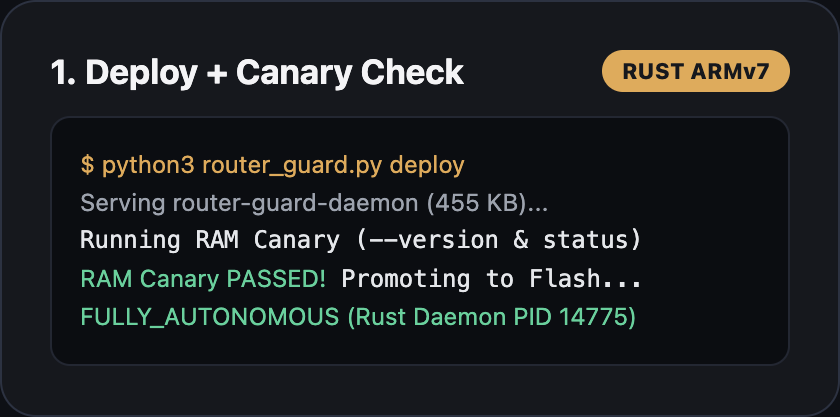<br/>
      <b>1. 单指令金丝雀部署</b><br/>
      <sub>推送静态编译的 ARMv7 Rust 守护进程 (<code>445 KB</code>) 至路由器 RAM 进行 ABI 金丝雀验证，确认无误后持久化至 Flash。</sub>
    </td>
    <td align="center" width="33%" valign="top">
      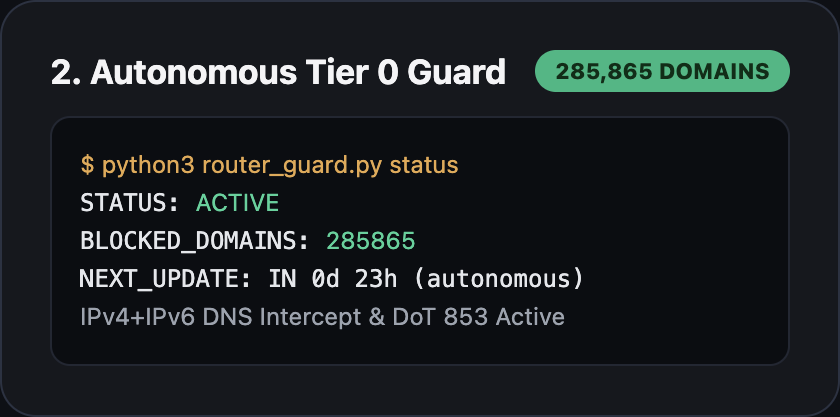<br/>
      <b>2. 每日全自动同步</b><br/>
      <sub>每日从 Tier 0 CDN 同步规则，结合 FNV-1a 增量校验实现 Flash 零磨损；固件异常重置 hosts 时 5 秒内自愈。</sub>
    </td>
    <td align="center" width="33%" valign="top">
      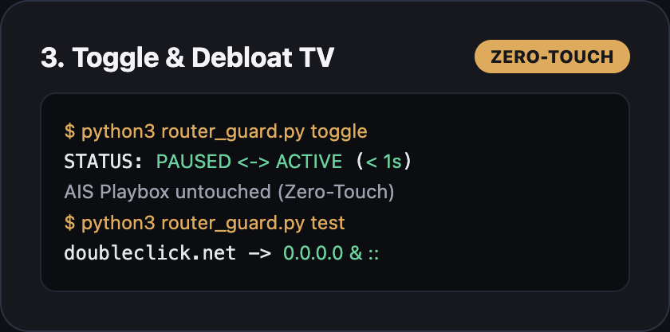<br/>
      <b>3. 毫秒级一键开关</b><br/>
      <sub>单指令在 <code>ACTIVE</code> 与 <code>PAUSED</code> 状态之间无缝切换，无需重启路由器，不产生掉线。</sub>
    </td>
  </tr>
</table>

---

## 📊 实测效果前后对比 (97% 拦截率)

使用独立第三方基准测试套件 [TurtleCute Ad Blocker Test suite](https://adblock.turtlecute.org/)（包含 130 个广告服务器、数据追踪、遥测与弹窗端点），通过 Kapture MCP 驱动 Chrome 浏览器自动化测试（2026-11-26 于 ZTE F6107A 重新截图）：

<p align="center">
  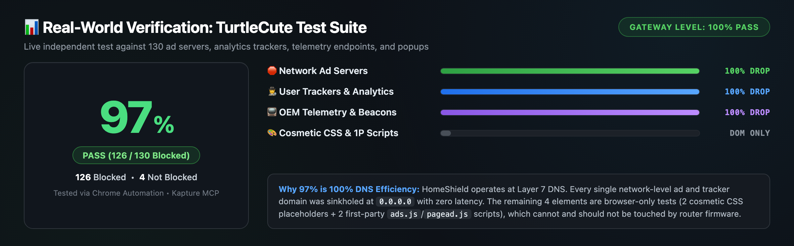
</p>

<table align="center" width="100%">
  <tr>
    <th align="center" width="50%">❌ 防护未开启 (PAUSED / 裸跑状态)</th>
    <th align="center" width="50%">✅ 防护开启后 (ACTIVE / HomeShield 生效)</th>
  </tr>
  <tr>
    <td align="center" width="50%" valign="top">
      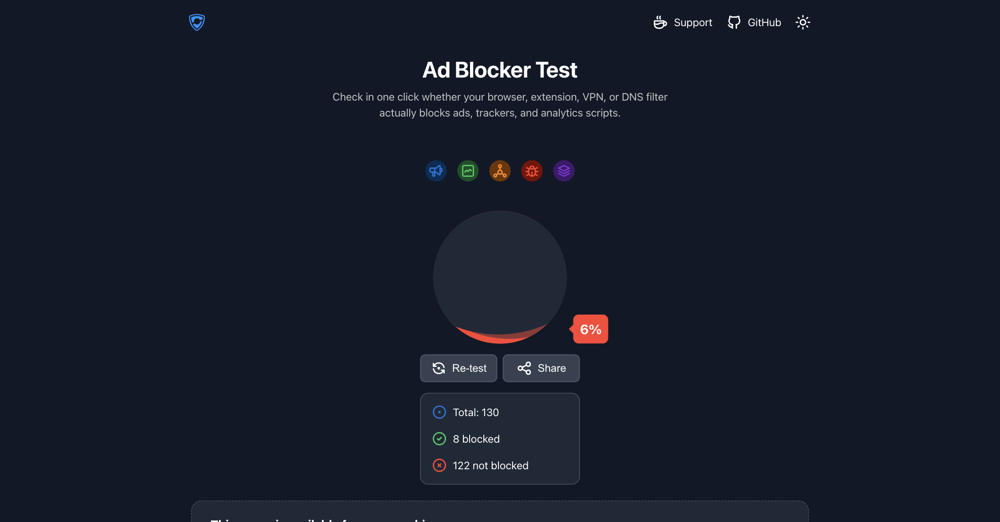<br/>
      <b>得分: 6% (拦截 8 / 130 项)</b><br/>
      <sub>高达 122 个广告追踪器、遥测数据点无阻碍渗入内网。</sub>
    </td>
    <td align="center" width="50%" valign="top">
      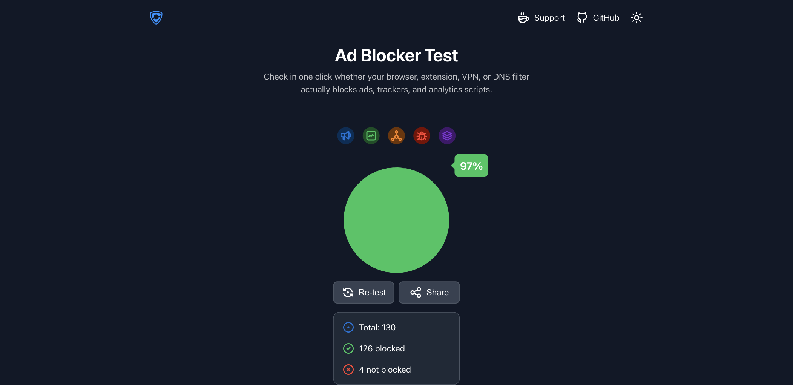<br/>
      <b>得分: 97% (拦截 126 / 130 项)</b><br/>
      <sub><b>126 个恶意与广告域名在网关处直接被拦截</b>（仅剩 4 项：2 项 CSS 广告占位隐藏 + 2 项测试站点自身的 <code>ads.js</code>/<code>pagead.js</code> 脚本，DNS 层无法识别）。</sub>
    </td>
  </tr>
</table>

> [!NOTE]
> **为什么 97% 是 DNS 网络层的理论极限拦截率：** DNS 沉洞拦截工作在网络 Layer 7。其余未阻断的项目属于前端页面的 DOM/CSS 空白占位隐藏，需配合浏览器插件如 uBlock Origin 进行样式剔除。所有通过网络发起的外部广告请求均已被降维拦截。

---

## 🏛️ 系统架构

HomeShield 采用**云端预编译与边缘零跳数拦截的解耦架构**：

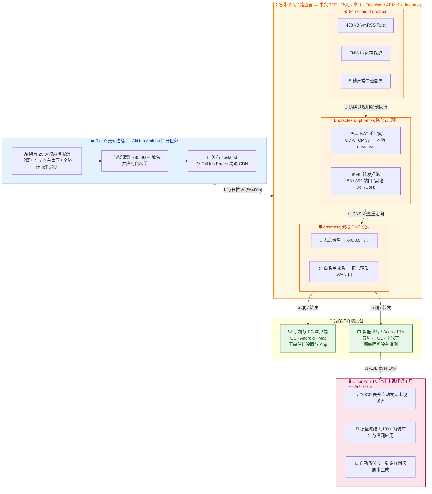

---

### Rollback Hierarchy Diagram (回滚层级图)

```mermaid
graph TD
    subgraph Rollback["🔄 HomeShield 4-Tier Rollback Hierarchy"]
        L1["🟢 Level 1: Soft-Rollback (Toggle)\nInstant pause — < 100 ms"]
        L2["🟡 Level 2: Engine Switch (Rust → Shell)\nZero downtime fallback — < 5 s"]
        L3["🔴 Level 3: Full Gateway Revert\nClean uninstall & factory state — < 30 s"]
        L4["🔵 Level 4: Smart TV Rollback\n1-Click ADB restoration — < 10 s"]
    end

    subgraph L1_Detail["🟢 Level 1: Instant Soft-Rollback"]
        L1_When["⚡ When: User reports website issue;\nimmediate unblocking needed"]
        L1_Action["💻 Action: python3 homeshield.py toggle\n--ip 192.168.1.1"]
        L1_Time["⏱️ Time: < 1 second"]
        L1_Impact["✅ Impact: Reverts DNS to unblocked\npass-through; daemon alive"]
    end

    subgraph L2_Detail["🟡 Level 2: Engine Fallback Rollback"]
        L2_When["⚡ When: Daemon kernel panic or\narchitecture warning"]
        L2_Action["💻 Action: python3 homeshield.py deploy\n--ip 192.168.1.1 --engine shell"]
        L2_Time["⏱️ Time: < 5 seconds"]
        L2_Impact["✅ Impact: Kills Rust binary, activates\nadblock.sh loop + watchdog.sh"]
    end

    subgraph L3_Detail["🔴 Level 3: Complete Gateway Rollback"]
        L3_When["⚡ When: Gateway firmware update,\nISP maintenance, or permanent removal"]
        L3_Action["💻 Action: python3 homeshield.py uninstall\n--ip 192.168.1.1"]
        L3_Time["⏱️ Time: < 30 seconds"]
        L3_Impact["✅ Impact: 100% factory state restored;\nzero leftover files on Flash ROM"]
    end

    subgraph L3_Manual["🚨 Level 3: Manual Emergency (Telnet)"]
        M1["1. killall homeshield-daemon\n    watchdog.sh adblock.sh"]
        M2["2. iptables/ip6tables -D\n    flush all DNS redirect rules"]
        M3["3. echo '127.0.0.1 localhost'\n    > /var/tmp/hosts\n    killall -HUP dnsmasq"]
        M4["4. rm -rf /userconfig/homeshield-*\n    /userconfig/adblock.*\n    /userconfig/watchdog.sh\n    /userconfig/whitelist.txt"]
    end

    subgraph L4_Detail["🔵 Level 4: Device & Smart TV Rollback"]
        L4_When["⚡ When: Debloated TV/device package\ncauses unwanted UI side-effect"]
        L4_Action1["🤖 Auto: sh backups/restore_ip_ts.sh"]
        L4_Action2["💻 CLI: cargo run -- device restore\n--target device_ip"]
        L4_Impact["✅ Impact: Re-enables all disabled\nAndroid packages to original state"]
    end

    L1 --> L1_When
    L1 --> L1_Action
    L1 --> L1_Time
    L1 --> L1_Impact
    L2 --> L2_When
    L2 --> L2_Action
    L2 --> L2_Time
    L2 --> L2_Impact
    L3 --> L3_When
    L3 --> L3_Action
    L3 --> L3_Time
    L3 --> L3_Impact
    L3_Detail --> L3_Manual
    L4 --> L4_When
    L4 --> L4_Action1
    L4 --> L4_Action2
    L4 --> L4_Impact

    classDef hierarchy fill:#f3e5f5,stroke:#6a1b9a,stroke-width:2px,color:#4a148c
    classDef level1 fill:#e8f5e9,stroke:#2e7d32,stroke-width:2px,color:#1b5e20
    classDef level2 fill:#fff8e1,stroke:#f57f17,stroke-width:2px,color:#e65100
    classDef level3 fill:#ffebee,stroke:#b71c1c,stroke-width:2px,color:#7f0000
    classDef level4 fill:#e3f2fd,stroke:#1565c0,stroke-width:2px,color:#0d47a1
    classDef manual fill:#fafafa,stroke:#757575,stroke-width:1px,stroke-dasharray: 5 5,color:#424242

    class Rollback hierarchy
    class L1,L1_When,L1_Action,L1_Time,L1_Impact level1
    class L2,L2_When,L2_Action,L2_Time,L2_Impact level2
    class L3,L3_When,L3_Action,L3_Time,L3_Impact,L3_Detail level3
    class L3_Manual,M1,M2,M3,M4 manual
    class L4,L4_When,L4_Action1,L4_Action2,L4_Impact level4
```

---

### Update Lifecycle Diagram (更新生命周期图)

```mermaid
graph TD
    subgraph Tier0["☁️ Tier 0 Cloud Automation — Daily at 23:00 UTC / 06:00 ICT Bangkok"]
        GH["🤖 GitHub Actions"]
        Pull["📥 Pull 29 Feeds\n(JoinSet Concurrent)"]
        Dedup["🔄 Deduplicate\n285,865+ unique domains"]
        CDN["🚀 CDN publish\nhosts.txt on GitHub Pages"]
        GH --> Pull --> Dedup --> CDN
    end

    CDN -.->|⬇️ Daily HTTP Pull (86400s)| Supervisor

    subgraph Supervisor["⚙️ Broadband Gateway Supervisor — Rust Daemon (Design-Pattern Optimized)"]
        Step1["🏗️ Step 1: Builder + Flyweight\nPre-size HashSet 300k+ & Arc-Whitelist — 0 clone"]
        Step2["🔐 Step 2: Integrity & FNV-1a\n128 KB streaming buffer delta check → Zero Flash Write"]
        Step3["📊 Step 3: Cache-Aside & Pool\nO(1) domain_count sidecar + reused String buffers"]
        Step4["⚡ Step 4: Atomic Memory Swap\nSIGHUP to dnsmasq — < 100 ms, zero dropped packets"]
        Step1 --> Step2 --> Step3 --> Step4
    end

    classDef tier0 fill:#e3f2fd,stroke:#1565c0,stroke-width:2px,color:#0d47a1
    classDef supervisor fill:#fff8e1,stroke:#f57f17,stroke-width:2px,color:#e65100
    classDef step fill:#f5f5f5,stroke:#616161,stroke-width:1px,stroke-dasharray: 5 5,color:#212121

    class Tier0 tier0
    class Supervisor supervisor
    class Step1,Step2,Step3,Step4 step
```

---

### Rollback Sequence Diagram (回滚序列图)

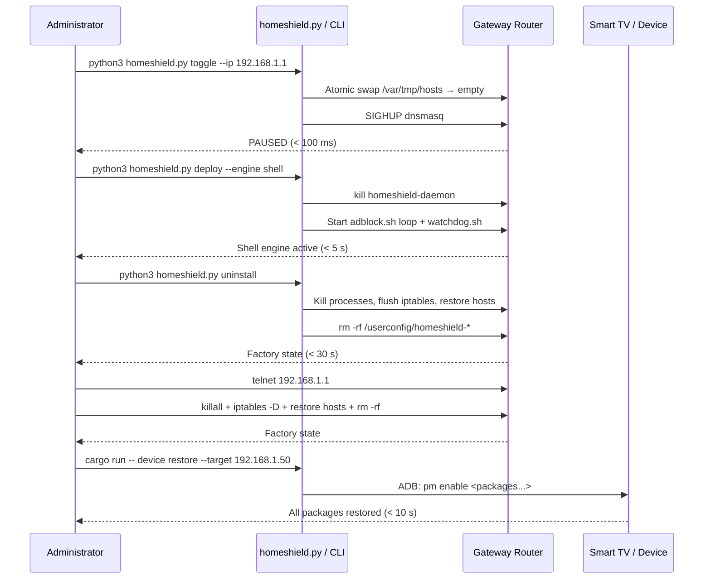

---

### Update Sequence Diagram (更新序列图)

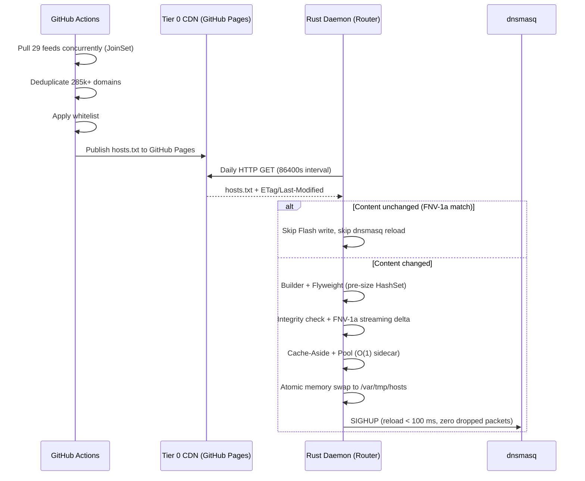

---

## 🛠️ 快速开始


### 1. 前置准备
- 拥有 Rust 工具链 (`cargo`) 的管理机 (macOS / Linux / Windows)，或 Python 3.9+ 环境
- 局域网内可达的路由器（默认 IP: `192.168.1.1`），支持 Telnet 或工厂模式

### 2. 一键部署到路由器
```bash
# 推荐: 使用 Rust 管理 CLI (具备 RAM 金丝雀测试与 Shell 自动回退保护)
cargo run --release --manifest-path rust/Cargo.toml -p homeshield-cli -- deploy --ip 192.168.1.1 --engine auto

# 或通过 Python 脚本执行:
python3 homeshield.py deploy --ip 192.168.1.1 --engine rust
```

### 3. 查看运行状态
```bash
cargo run --release --manifest-path rust/Cargo.toml -p homeshield-cli -- status --ip 192.168.1.1
```
*状态输出示例:*
```text
STATUS: ACTIVE
BLOCKED_DOMAINS: 285079
LAST_UPDATE: 2026-11-25 07:57:27
NEXT_UPDATE: IN 0d 20h (autonomous)
ROUTER_AUTONOMY: FULLY_AUTONOMOUS (Rust Daemon PID 17660)
```

### 4. 临时开关防护 (Toggle Switch)
```bash
cargo run --release --manifest-path rust/Cargo.toml -p homeshield-cli -- toggle --ip 192.168.1.1
```

### 5. 白名单管理
```bash
# 查看当前生效的白名单
python3 homeshield.py whitelist --whitelist-action list

# 添加放行域名
python3 homeshield.py whitelist --whitelist-action add --domain custom-domain.com

# 移除放行域名
python3 homeshield.py whitelist --whitelist-action remove --domain custom-domain.com
```

### 6. 全设备与智能电视遥测清理 (`device` / `tv`)
全面支持 **智能电视、安卓手机/平板（小米、三星、华为、OPPO、Vivo）、网络摄像头与智能中枢**（采用 Scatter-Gather 并行扫描探测）：
```bash
# 1. 从路由器 DHCP/ARP 表自动发现电视、手机、摄像头等 IoT 设备
cargo run --release --manifest-path rust/Cargo.toml -p homeshield-cli -- device discover --ip 192.168.1.1
# 或使用兼容别名: cargo run --release --manifest-path rust/Cargo.toml -p homeshield-cli -- tv discover --ip 192.168.1.1

# 2. 分析设备上安装的广告与 OEM 遥测软件包
cargo run --release --manifest-path rust/Cargo.toml -p homeshield-cli -- device analyze --target 192.168.1.50

# 3. 模拟优化过程 (Dry Run，不改动任何数据)
cargo run --release --manifest-path rust/Cargo.toml -p homeshield-cli -- device clean --target 192.168.1.50 --dry-run

# 4. 执行安全净化 (自动生成快照备份与一键还原脚本)
cargo run --release --manifest-path rust/Cargo.toml -p homeshield-cli -- device clean --target 192.168.1.50

# 5. 随时恢复设备至原始状态
cargo run --release --manifest-path rust/Cargo.toml -p homeshield-cli -- device restore --target 192.168.1.50
```

---

## 🌐 威胁情报源与自动更新机制

HomeShield 整合并动态维护 **29 个权威上游威胁情报源**，覆盖全网广告、东南亚及泰国诈骗网站、博彩陷阱以及覆盖智能电视、手机、摄像头、智能音箱与 Windows/macOS 电脑的全终端遥测屏蔽，并通过 GitHub Actions 每日预编译发布至 CDN：

### 🛡️ 29 大上游情报源全景

| 防护类别 / 层级 | 上游威胁情报源 | 防御的威胁目标 | 更新频率 |
| :--- | :--- | :--- | :---: |
| **全网广告与追踪过滤** | • [HaGeZi Multi NORMAL](https://github.com/hagezi/dns-blocklists)<br/>• [HaGeZi Ultimate](https://github.com/hagezi/dns-blocklists)<br/>• [HaGeZi Popup Ads](https://github.com/hagezi/dns-blocklists) | 跨域广告联盟、隐蔽弹窗、各类分析数据统计上报 | 每日 |
| **金融诈骗与钓鱼防御** | • [HaGeZi Fake Domains](https://github.com/hagezi/dns-blocklists)<br/>• [HaGeZi Threat Intelligence (TIF Mini)](https://github.com/hagezi/dns-blocklists)<br/>• [StevenBlack Fake News & Gambling](https://github.com/StevenBlack/hosts) | 冒充银行与政府网站、虚假 APK 下载、高仿李鬼域名、凭据收割 | 每日 |
| **泰国及东南亚本地规则** | • [hostsVN (东南亚广告与博彩)](https://github.com/bigdargon/hostsVN)<br/>• [Thai Adblock List (PhyschicWinter9)](https://github.com/PhyschicWinter9/thai-adblock-list)<br/>• [AdBlock Thai Filters (Ads & NextDNS/ABP)](https://github.com/Faelayis/AdBlock-Thai-Filters) | 东南亚及泰国本地欺诈弹窗、非法赌博与恶意推广域名 | 每日 |
| **赌博与不良信息拦截** | • [HaGeZi Gambling Medium](https://github.com/hagezi/dns-blocklists)<br/>• StevenBlack Gambling Alternates | 非法网络赌博、网络赌场、电子游艺诱导链接 | 每日 |
| **全终端 IoT、电视与手机 OEM** | • HaGeZi Native Samsung, LG webOS & Roku<br/>• HaGeZi Native Xiaomi, Huawei, OPPO/Realme & Vivo<br/>• HaGeZi Native Amazon (Echo/FireTV) & Apple<br/>• HaGeZi Native TikTok Telemetry | 电视语音与收视回传、各品牌手机系统遥测、智能音箱与流媒体盒子上报 | 每周 / 每日 |
| **Windows 与桌面系统遥测** | • [HaGeZi Native Windows & Office](https://github.com/hagezi/dns-blocklists)<br/>• [WindowsSpyBlocker (crazy-max)](https://github.com/crazy-max/WindowsSpyBlocker) | Windows 10/11 诊断数据上传、Microsoft Office 后台遥测上报 | 每周 / 每日 |
| **基准测试对齐源** | • [TurtleCute d3host.txt](https://github.com/Turtlecute33/adblocktest)<br/>• TurtleCute d3host.adblock | 与第三方独立 TurtleCute 130 项基准测试标准保持实时对齐 | 每周 |
| **区域与视频流媒体优化** | • [Johnshall Shadowrocket Rules](https://github.com/Johnshall/Shadowrocket-ADBlock-Rules-Forever)<br/>• [h2y Shadowrocket Top 500 Banlist](https://github.com/h2y/Shadowrocket-ADBlock-Rules)<br/>• [Froggeric NoYouTubeAdsDNS](https://github.com/froggeric/DNS-blocklists) | 移动端插屏广告、流媒体广告服务器、亚洲主流推广网络 | 每周 |
| **防绕过与 DoH 泄漏防御** | • HaGeZi DoH / VPN / Proxy Bypass<br/>• HomeShield 金丝雀注入 (`use-application-dns.net`, `mask.icloud.com`) | 恶意加密 DNS 绕过、Firefox DoH 旁路、苹果私人代理泄漏 | 每日 |

### 🔄 自动更新机制与性能优化设计模式

1. **云端并发预编译 (每日 07:00 北京时间 / 06:00 曼谷时间):** GitHub Actions 通过 `JoinSet` 并发拉取 29 个上游源，结合 **Builder 模式**（预分配 `300,000+` 哈希桶与数组容量避免 O(n) 重哈希）去重并剥离白名单，发布单一 `hosts.txt` 至 CDN。
2. **享元与缓冲复用优化 (Flyweight + Buffer Reuse):** 守护进程通过 `Arc` 零拷贝共享白名单，配合 **128 KB 流式 I/O 缓冲** 与单字符串行缓冲复用（消除 60 万+ 次堆分配），并用 FNV-1a 校验跳过无变化的 Flash 写入。
3. **Cache-Aside 与单次扫描 `/proc` (Single-Pass Visitor):** 更新时写入 O(1) 领域计数缓存文件供 `status` 秒级读取，并用单次 `/proc` 遍历将系统调用降低 3 倍。
4. **内存原子热加载:** 发送 `SIGHUP` 信号给 `dnsmasq`，在 100 毫秒内加载新规则，全屋网络连接保持通畅。

#### 手动触发更新命令：
```bash
# 通过 Rust CLI:
cargo run --release --manifest-path rust/Cargo.toml -p homeshield-cli -- update --ip 192.168.1.1

# 或通过 Python:
python3 homeshield.py update --ip 192.168.1.1
```

---

## 🔒 嵌入式安全设计原则

| 安全保障机制 | 技术实现细节 |
| :--- | :--- |
| **故障关闭保护 (Fail-Closed)** | 若下载规则损坏或不完整，系统自动保留原有规则继续生效，绝不影响家庭宽带联网。 |
| **内存优先运行 (RAM-First)** | 所有验证、解包与测试均在内存盘运行，只有通过安全检查的组件才会固化至 Flash ROM。 |
| **NTP 时钟防护** | 若路由器重启时尚未同步网络时间 (时钟重置为 1970 年)，系统将推迟更新，防止时间错乱。 |
| **免触碰电视保护 (Zero-Touch)** | 自动识别并保留运营商光猫的 IPTV 业务通道，绝不中断有线电视与正版直播。 |

---

## 📜 隐私与开源协议

- **100% 本地运行:** 所有 DNS 拦截均在本地路由器完成，HomeShield 绝不收集、不记录、不上传任何浏览记录与隐私数据。
- **完全开源:** 项目所有构建与规则编译流程均在 GitHub Actions 公开透明执行。
- 遵循 [MIT License](LICENSE) 开源协议。
