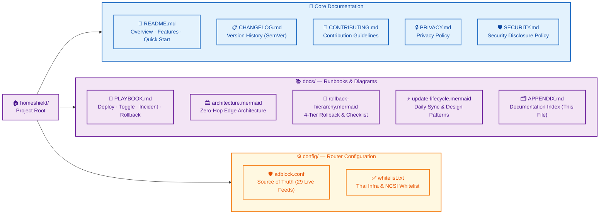

# HomeShield — Documentation Appendix & Index

> **Purpose:** Single entry point linking every document, configuration file, and code module in the HomeShield repository.

---

## 📚 Documentation Map



---

## 🔗 Document Reference Index

| Document | Purpose | Audience |
|----------|---------|----------|
| [README.md](../README.md) | Project intro, security pillars, before/after screenshots, quick start | Everyone |
| [CHANGELOG.md](../CHANGELOG.md) | Full version history (v0.1.0 → v1.2.0) | Maintainers, contributors |
| [CONTRIBUTING.md](../CONTRIBUTING.md) | How to contribute code, file issues | Contributors |
| [PRIVACY.md](../PRIVACY.md) | Data handling and privacy guarantees | End users |
| [SECURITY.md](../SECURITY.md) | Vulnerability disclosure process | Security researchers |
| [docs/PLAYBOOK.md](PLAYBOOK.md) | Day-to-day operations: deploy, toggle, rollback | Operators |
| [docs/architecture.mermaid](architecture.mermaid) | Standalone Zero-Hop Edge Architecture diagram (Mermaid) | Architects, devs |
| [docs/rollback-hierarchy.mermaid](rollback-hierarchy.mermaid) | Standalone 4-Tier Rollback hierarchy & verification checklist | Operators, devs |
| [docs/update-lifecycle.mermaid](update-lifecycle.mermaid) | Standalone Daily Sync & Design Patterns diagram (Mermaid) | Maintainers, devs |
| [docs/APPENDIX.md](APPENDIX.md) | This index | Everyone |

### 🌐 Localized READMEs (16 Languages)
- [English (`README.md`)](../README.md) • [ภาษาไทย (`README.th.md`)](../README.th.md) • [简体中文 (`README.zh-CN.md`)](../README.zh-CN.md) • [العربية (`README.ar.md`)](../README.ar.md)
- [Deutsch (`README.de.md`)](../README.de.md) • [Ελληνικά (`README.el.md`)](../README.el.md) • [Español (`README.es.md`)](../README.es.md) • [Français (`README.fr.md`)](../README.fr.md)
- [עברית (`README.he.md`)](../README.he.md) • [Italiano (`README.it.md`)](../README.it.md) • [日本語 (`README.ja.md`)](../README.ja.md) • [Nederlands (`README.nl.md`)](../README.nl.md)
- [Português (`README.pt.md`)](../README.pt.md) • [Українська (`README.uk.md`)](../README.uk.md) • [Oʻzbekcha (`README.uz.md`)](../README.uz.md) • [Tiếng Việt (`README.vi.md`)](../README.vi.md)

---

## ⚙️ Configuration Files

| File | Description |
|------|-------------|
| [`config/adblock.conf`](../config/adblock.conf) | **Single source of truth** for all 29 blocklist URLs, CDN URL, and feature flags |
| [`config/whitelist.txt`](../config/whitelist.txt) | Domains **excluded** from blocking (Thai banks, AIS, TRUE, ISP infra, Apple/Google/MS NCSI connectivity) |

### `adblock.conf` Key Parameters

| Variable | Default | Purpose |
|----------|---------|---------|
| `PRIMARY_CDN_URL` | GitHub Pages URL | Tier 0 pre-compiled hosts.txt (fastest path) |
| `BLOCKLIST_URLS` | 29 raw GitHub URLs | Fallback multi-source feeds (Ad/Scam/Thai-SEA/IoT/PC Telemetry) |
| `UPDATE_INTERVAL_SECONDS` | `86400` (24h) | Autonomous sync cadence |
| `BLOCK_DOT` | `1` | Block DNS-over-TLS (port 853) |
| `BLOCK_CANARY_DOH` | `1` | Block Firefox DoH bypass domain |
| `BLOCK_APPLE_PRIVATE_RELAY` | `1` | Block Apple iCloud Private Relay |

---

## 🗂️ Blocklist Sources (29 Live Feeds)

| # | Repository | File | Category |
|---|-----------|------|----------|
| 1 | hagezi/dns-blocklists | `adblock/multi.txt` | General ads & tracking |
| 2 | hagezi/dns-blocklists | `adblock/native.samsung.txt` | Samsung OEM telemetry |
| 3 | hagezi/dns-blocklists | `adblock/native.lgwebos.txt` | LG webOS TV telemetry |
| 4 | hagezi/dns-blocklists | `adblock/native.xiaomi.txt` | Xiaomi OEM telemetry |
| 5 | hagezi/dns-blocklists | `adblock/native.tiktok.txt` | TikTok tracking |
| 6 | hagezi/dns-blocklists | `adblock/popupads.txt` | Popup ads |
| 7 | StevenBlack/hosts | `alternates/fakenews-gambling/hosts` | Fake news & gambling |
| 8 | froggeric/DNS-blocklists | `NoYouTubeAdsDNS` | YouTube ads (DNS-level) |
| 9 | Turtlecute33/adblocktest | `src/d3host.txt` | TurtleCute test suite |
| 10 | Turtlecute33/adblocktest | `src/d3host.adblock` | TurtleCute test suite (Adblock+ format) |
| 11 | Johnshall/Shadowrocket-ADBlock-Rules-Forever | `release/sr_ad_only.conf` | Shadowrocket ad rules |
| 12 | hagezi/dns-blocklists | `adblock/fake.txt` | Fake/scam sites |
| 13 | hagezi/dns-blocklists | `adblock/gambling.medium.txt` | Gambling sites (medium) |
| 14 | hagezi/dns-blocklists | `adblock/tif.mini.txt` | Threat Intelligence (mini) |
| 15 | hagezi/dns-blocklists | `adblock/doh-vpn-proxy-bypass.txt` | DoH/VPN/proxy bypass |
| 16 | hagezi/dns-blocklists | `adblock/ultimate.txt` | Ultimate comprehensive list |
| 17 | h2y/Shadowrocket-ADBlock-Rules | `sr_top500_banlist.conf` | Top 500 ad domains |
| 18 | bigdargon/hostsVN | `hosts` | Vietnam & SEA ads/gambling |
| 19 | PhyschicWinter9/thai-adblock-list | `thai-adblock-list.txt` | Thai regional adblock list |
| 20 | Faelayis/AdBlock-Thai-Filters | `filters/ads.txt` | Thai ad & scam filters |
| 21 | Faelayis/AdBlock-Thai-Filters | `nextdns/abp.txt` | Thai streaming/gambling ABP rules |
| 22 | hagezi/dns-blocklists | `adblock/native.amazon.txt` | Amazon Echo/Alexa/FireTV telemetry |
| 23 | hagezi/dns-blocklists | `adblock/native.apple.txt` | Apple iOS/macOS/AppleTV telemetry |
| 24 | hagezi/dns-blocklists | `adblock/native.huawei.txt` | Huawei/HarmonyOS/IoT telemetry |
| 25 | hagezi/dns-blocklists | `adblock/native.oppo-realme.txt` | OPPO & Realme mobile telemetry |
| 26 | hagezi/dns-blocklists | `adblock/native.vivo.txt` | Vivo smartphone telemetry |
| 27 | hagezi/dns-blocklists | `adblock/native.roku.txt` | Roku Smart TV/stick telemetry |
| 28 | hagezi/dns-blocklists | `adblock/native.winoffice.txt` | Windows & Microsoft Office telemetry |
| 29 | crazy-max/WindowsSpyBlocker | `data/hosts/spy.txt` | Windows 10/11 telemetry & spyware |

---

## 🏗️ Code Architecture

### Python Layer (Management CLI)

| File | Lines | Purpose |
|------|-------|---------|
| [`homeshield.py`](../homeshield.py) | 451 | Main CLI: deploy, update, status, toggle, uninstall |
| [`core/__init__.py`](../core/__init__.py) | — | Package init |
| [`core/factory_mode.py`](../core/factory_mode.py) | — | ZTE factory mode credential negotiation |
| [`core/telnet_client.py`](../core/telnet_client.py) | — | Telnet session management |
| [`core/tv_manager.py`](../core/tv_manager.py) | — | CleanYourTV: ADB-based Android TV debloat |
| [`core/zte_crypto.py`](../core/zte_crypto.py) | — | ZTE router crypto utilities |

### Shell Engine (Runs on Router)

| File | Lines | Purpose |
|------|-------|---------|
| [`scripts/adblock.sh`](../scripts/adblock.sh) | 295 | Blocklist engine: download, parse, apply, toggle |
| [`scripts/watchdog.sh`](../scripts/watchdog.sh) | 71 | Supervisor: self-healing loop + iptables anti-bypass rules |

### Rust Daemon (Embedded ARMv7 Binary)

| File | Purpose |
|------|---------|
| [`rust/crates/core/src/config.rs`](../rust/crates/core/src/config.rs) | Config parser (reads `adblock.conf`) |
| [`rust/crates/core/src/blocklist.rs`](../rust/crates/core/src/blocklist.rs) | Universal hosts/adblock/plain-domain parser |
| [`rust/crates/core/src/lib.rs`](../rust/crates/core/src/lib.rs) | Library root |
| [`rust/crates/daemon/src/engine.rs`](../rust/crates/daemon/src/engine.rs) | AdblockEngine: update, apply, check |
| [`rust/crates/daemon/src/supervisor.rs`](../rust/crates/daemon/src/supervisor.rs) | Supervisor tick loop & self-healing |
| [`rust/crates/daemon/src/system.rs`](../rust/crates/daemon/src/system.rs) | SystemOps trait (testable abstraction) |
| [`rust/crates/daemon/src/main.rs`](../rust/crates/daemon/src/main.rs) | Binary entrypoint |
| [`rust/crates/daemon/src/tests.rs`](../rust/crates/daemon/src/tests.rs) | Daemon integration tests |

### Cloud CI Pipeline

| File | Purpose |
|------|---------|
| [`scripts/compile_blocklist.py`](../scripts/compile_blocklist.py) | Tier 0 pre-compiler: fetch → deduplicate → whitelist → publish |
| [`.github/workflows/compile-blocklist.yml`](../.github/workflows/compile-blocklist.yml) | Daily CI: compile → health-check → deploy to GitHub Pages (Actions artifact) |
| [`.github/workflows/rust-daemon.yml`](../.github/workflows/rust-daemon.yml) | Cross-compile ARMv7 Rust binary + run tests |

---

## 🧪 Test Suite

| File | Coverage |
|------|---------|
| [`tests/test_scripts.py`](../tests/test_scripts.py) | Shell script syntax, awk parser, adblock.conf |
| [`tests/test_rust_daemon.py`](../tests/test_rust_daemon.py) | Rust daemon binary health check |
| [`tests/test_tier0_and_canary.py`](../tests/test_tier0_and_canary.py) | Tier 0 CDN + canary domain logic |
| [`tests/test_tv_manager.py`](../tests/test_tv_manager.py) | CleanYourTV manager |
| Rust unit tests (via `cargo test`) | Config parser, URL normalizer, blocklist parser, whitelist parity |

---

## 🚀 Quick Start Reference

```bash
# 1. Deploy HomeShield to router
python3 homeshield.py deploy --ip 192.168.1.1

# 2. Force blocklist update
python3 homeshield.py update --ip 192.168.1.1

# 3. Check router status
python3 homeshield.py status --ip 192.168.1.1

# 4. Toggle active/paused
python3 homeshield.py toggle --ip 192.168.1.1

# 5. Uninstall
python3 homeshield.py uninstall --ip 192.168.1.1
```

---

## ✅ Recent Engineering Improvements (v1.2.0)

| Component | Improvement & Design Pattern | Status |
|-----------|------------------------------|--------|
| Tier 0 Compiler & Daemon | **Builder & Flyweight Patterns**: `with_capacity(300k+)` + `Arc<HashSet<String>>` whitelist sharing | **Implemented** |
| Hosts I/O & FNV-1a Hashing | **Buffer Reuse Pattern + 128 KB streaming buffers** eliminating 600k+ heap allocations | **Implemented** |
| Status Reporting & Watchdog | **Cache-Aside Pattern** (`domain_count` sidecar) + **Single-Pass `/proc` Visitor** | **Implemented** |
| Universal Device Telemetry | **Scatter-Gather (`JoinSet`) LAN probing** + **Device Classifier Strategy** + 29 Live Feeds (TV, Mobile, Camera, Speaker, Windows/macOS) | **Implemented** |

---

*Updated: 2026-11-25 | HomeShield v1.2.0*
