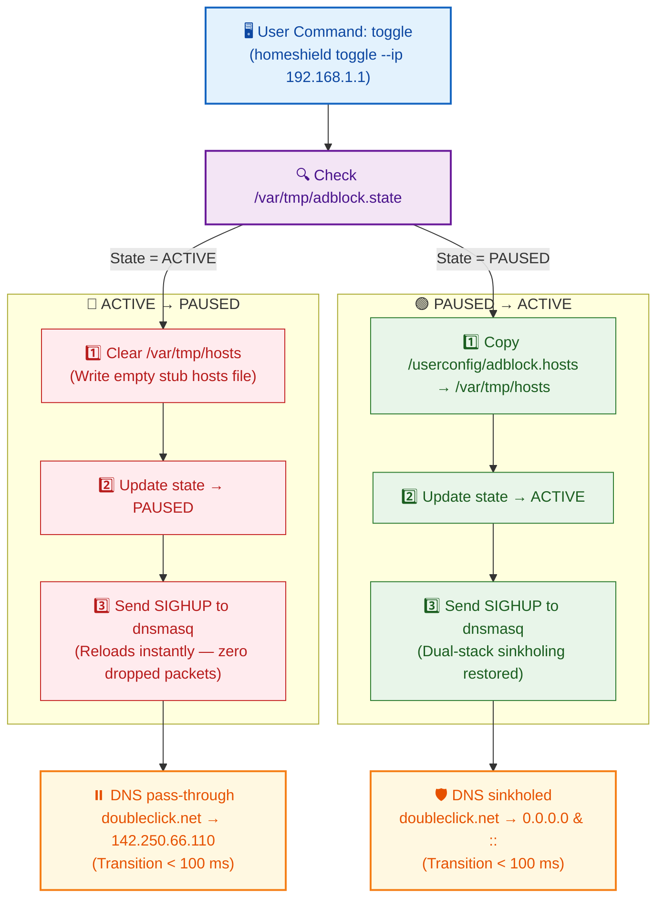

# 📖 HomeShield Operations Playbook & Rollback Plan

> **Carrier-Grade Operational Runbook, Disaster Recovery, and Fail-Safe Rollback Strategy**  
> *Target Environments: GPON/EPON ONTs, OpenWrt Gateways, Asuswrt-Merlin Routers, and Managed L3 Switches.*

---

## 📑 Table of Contents

1. [Operational Overview & Safety Principles](#1-operational-overview--safety-principles)
2. [Phase 1: Pre-Flight & Readiness Check](#2-phase-1-pre-flight--readiness-check)
3. [Phase 2: Deployment & RAM Canary Verification](#3-phase-2-deployment--ram-canary-verification)
4. [Phase 3: Routine Operations & Health Auditing](#4-phase-3-routine-operations--health-auditing)
5. [Phase 4: The Atomic Toggle Feature Playbook](#5-phase-4-the-atomic-toggle-feature-playbook)
6. [Phase 5: Whitelist & Exception Management](#6-phase-5-whitelist--exception-management)
7. [Phase 6: Smart TV Companion Operations](#7-phase-6-smart-tv-companion-operations)
8. [Phase 7: Incident Response Runbook](#8-phase-7-incident-response-runbook)
9. [Phase 8: Multi-Tier Rollback & Disaster Recovery Plan](#9-phase-8-multi-tier-rollback--disaster-recovery-plan)
10. [Post-Rollback Health Checklist](#10-post-rollback-health-checklist)

---

## 1. Operational Overview & Safety Principles

HomeShield runs directly inside resource-constrained network gateways (such as ZTE ZXHN, Huawei EchoLife, ASUS, and OpenWrt devices with 256–512 MB RAM and 8–16 MB Flash). All operations must adhere to three foundational rules:

1. **Zero Flash Wear:** Never write volatile or unverified data directly to `/userconfig/` (NAND Flash). Everything is processed in RAM (`/var/tmpfs`) and promoted to Flash only after size and FNV-1a checksum verification.
2. **Fail-Closed Gatekeeper:** If upstream feeds or CDN artifacts return fewer unique valid domains than `min_valid_lines` (default: 1,000), the update is aborted and the active sinkhole remains untouched.
3. **Zero-Touch Client Policy:** Never modify, sideload, or alter carrier set-top boxes, digital TV entitlement services, or client root certificates.

---

## 2. Phase 1: Pre-Flight & Readiness Check

Before deploying or performing maintenance on a gateway, execute pre-flight checks from your management workstation:

```bash
# 1. Verify network reachability and latency to gateway
ping -c 3 192.168.1.1

# 2. Verify gateway port 23 (Telnet) or 22 (SSH) availability
nc -zv 192.168.1.1 23 || nc -zv 192.168.1.1 22

# 3. Verify workstation Python environment & dependencies
python3 -m pytest tests/ -q
```

*Expected Status:* Ping response `< 2 ms`, port open, all tests passed (23 Rust + 23 Python = 46).

---

## 3. Phase 2: Deployment & RAM Canary Verification

HomeShield employs a **Two-Stage RAM Canary Deployment** to eliminate bricking risks:

```bash
# Deploy embedded Rust daemon (default)
python3 homeshield.py deploy --ip 192.168.1.1 --engine rust
```

### What Happens Internally:
1. **RAM Staging:** Daemon binary (`445 KB`) is downloaded into volatile RAM (`/var/tmp/homeshield-daemon`).
2. **Canary Execution:** The router executes `/var/tmp/homeshield-daemon --version` and `status` in memory.
3. **Promotion on Success:** Only when the canary returns exit code `0` is the binary promoted to persistent Flash (`/userconfig/homeshield-daemon`).
4. **Auto-Rollback on ABI Failure:** If the binary fails (e.g. `SIGILL` due to float ABI incompatibility), the deployment script immediately purges RAM and falls back to the universal POSIX shell engine (`scripts/adblock.sh`).

---

## 4. Phase 3: Routine Operations & Health Auditing

### Daily Autonomous Health Check
HomeShield refreshes blocklists automatically every 24 hours (`UPDATE_INTERVAL_SECONDS = 86400`). To audit live status:

```bash
python3 homeshield.py status --ip 192.168.1.1
```

*Expected Output:*
```text
STATUS: ACTIVE
BLOCKED_DOMAINS: 552276
LAST_UPDATE: 2026-11-25 03:06:17
NEXT_UPDATE: IN 0d 13h (autonomous)
ROUTER_AUTONOMY: FULLY_AUTONOMOUS (Rust Daemon PID 14775)
```

### Manual Trigger for Blocklist Sync
```bash
python3 homeshield.py update --ip 192.168.1.1
```
*Flash Protection Guarantee:* If the CDN blocklist has not changed, the FNV-1a checksum check will skip rewriting Flash ROM and skip restarting `dnsmasq`.

---

## 5. Phase 4: The Atomic Toggle Feature Playbook

The **Toggle Feature** allows administrators or family members to instantly pause or resume network-wide ad blocking without rebooting the router, killing background daemons, or interrupting active connections.

### Operational Use Cases:
- **Streaming Ad-Gated Video:** Temporarily pausing to allow a mandatory reward ad on a smartphone or game console.
- **Diagnostic Testing:** Verifying whether a site's visual glitch is caused by DNS blocking or an external CDN outage.
- **A/B Performance Auditing:** Running Before/After tests (such as TurtleCute or Speedtest) to measure DNS latency.

### How to Execute:
```bash
# Toggle state in a single command (from workstation)
python3 homeshield.py toggle --ip 192.168.1.1
```

Or directly inside the router terminal:
```sh
/userconfig/homeshield-daemon toggle
# Or on shell engine:
/userconfig/adblock.sh toggle
```

### State Transition Matrix:

| Current State | Command | New State | DNS Resolution for `doubleclick.net` | Transition Time | Daemon State |
| :---: | :---: | :---: | :---: | :---: | :---: |
| **ACTIVE** | `toggle` | **PAUSED** | Resolved to real IP (e.g. `142.250.66.110`) | `< 100 ms` | Running (Timer intact) |
| **PAUSED** | `toggle` | **ACTIVE** | Sinkholed to `0.0.0.0` & `::` | `< 100 ms` | Running (Timer intact) |

### Technical Mechanism:



---

## 6. Phase 5: Whitelist & Exception Management

To ensure zero breakage of essential digital services (mobile banking, government services, push notifications):

```bash
# 1. List active whitelisted domains
python3 homeshield.py whitelist --whitelist-action list

# 2. Add domain to whitelist (Instant reload)
python3 homeshield.py whitelist --whitelist-action add --domain portal.service.gov

# 3. Remove domain from whitelist
python3 homeshield.py whitelist --whitelist-action remove --domain tracker-test.com
```

---

## 7. Phase 6: Universal Device & Smart TV Companion Operations

HomeShield's device companion manages Android TV, Google TV, Fire TV, and ADB-enabled smartphones/tablets/IoT devices over Wi-Fi without installing client apps:

```bash
# Step 1: Discover TVs, Phones, Cameras & IoT devices from Router DHCP/ARP table
cargo run --release --manifest-path rust/Cargo.toml -p homeshield-cli -- device discover --ip 192.168.1.1
# Or via Python: python3 homeshield.py device --tv-action discover

# Step 2: Audit installed packages against CleanYourTV + built-in OEM telemetry facts
cargo run --release --manifest-path rust/Cargo.toml -p homeshield-cli -- device analyze --target 192.168.1.50

# Step 3: Run safe simulation (Dry Run)
cargo run --release --manifest-path rust/Cargo.toml -p homeshield-cli -- device clean --target 192.168.1.50 --dry-run

# Step 4: Execute safe debloat (Auto-generates backup & standalone rollback script)
cargo run --release --manifest-path rust/Cargo.toml -p homeshield-cli -- device clean --target 192.168.1.50
```

---

## 8. Phase 7: Incident Response Runbook

### Incident A: Clients Report Websites Not Loading
1. **Diagnosis:** Run `python3 homeshield.py test --ip 192.168.1.1`
2. **Immediate Action:** Execute `python3 homeshield.py toggle --ip 192.168.1.1` (Switches to `PAUSED`).
3. **If resolved:** The issue was an upstream domain block. Add domain to whitelist (`whitelist --whitelist-action add --domain <domain>`).
4. **If NOT resolved:** Issue is with upstream WAN DNS or physical link, unrelated to sinkhole.

### Incident B: Gateway Firmware Overwrites `/var/tmp/hosts`
- **Root Cause:** Firmware daemon (`cspd`) re-generates `/var/tmp/hosts` on WAN PPPoE reconnect.
- **Autonomous Recovery:** HomeShield's `Supervisor::tick()` checks file length every 5 seconds. If `system_hosts < ram_hosts`, it automatically re-links `/var/tmp/hosts` and signals `dnsmasq`.
- **Manual Force-Fix:** Run `python3 homeshield.py update --ip 192.168.1.1`.

### Incident C: Out-Of-Memory (OOM) Alarm on Router
1. Verify RAM footprint: `python3 homeshield.py status`.
2. Check memory on router via Telnet: `cat /proc/meminfo | grep MemFree`.
3. If memory is low (`< 15 MB`), switch to shell engine: `python3 homeshield.py deploy --ip 192.168.1.1 --engine shell`.

---

## 9. Phase 8: Multi-Tier Rollback & Disaster Recovery Plan

HomeShield provides four distinct levels of rollback depending on operational necessity:

```mermaid
graph TD
    %% Rollback Hierarchy Overview
    subgraph Rollback["🔄 HomeShield 4-Tier Rollback Hierarchy"]
        L1["🟢 Level 1: Soft-Rollback (Toggle)\nInstant pause — < 100 ms"]
        L2["🟡 Level 2: Engine Switch (Rust → Shell)\nZero downtime fallback — < 5 s"]
        L3["🔴 Level 3: Full Gateway Revert\nClean uninstall & factory state — < 30 s"]
        L4["🔵 Level 4: Smart TV Rollback\n1-Click ADB restoration — < 10 s"]
    end

    %% Level 1 Details
    subgraph L1_Detail["🟢 Level 1: Instant Soft-Rollback"]
        L1_When["⚡ When: User reports website issue;\nimmediate unblocking needed"]
        L1_Action["💻 Action: python3 homeshield.py toggle\n--ip 192.168.1.1"]
        L1_Time["⏱️ Time: < 1 second"]
        L1_Impact["✅ Impact: Reverts DNS to unblocked\npass-through; daemon alive"]
    end

    %% Level 2 Details
    subgraph L2_Detail["🟡 Level 2: Engine Fallback Rollback"]
        L2_When["⚡ When: Daemon kernel panic or\narchitecture warning"]
        L2_Action["💻 Action: python3 homeshield.py deploy\n--ip 192.168.1.1 --engine shell"]
        L2_Time["⏱️ Time: < 5 seconds"]
        L2_Impact["✅ Impact: Kills Rust binary, activates\nadblock.sh loop + watchdog.sh"]
    end

    %% Level 3 Details
    subgraph L3_Detail["🔴 Level 3: Complete Gateway Rollback"]
        L3_When["⚡ When: Gateway firmware update,\nISP maintenance, or permanent removal"]
        L3_Action["💻 Action: python3 homeshield.py uninstall\n--ip 192.168.1.1"]
        L3_Time["⏱️ Time: < 30 seconds"]
        L3_Impact["✅ Impact: 100% factory state restored;\nzero leftover files on Flash ROM"]
    end

    %% Level 3 Manual Emergency
    subgraph L3_Manual["🚨 Level 3: Manual Emergency (Telnet)"]
        M1["1. killall homeshield-daemon\n    watchdog.sh adblock.sh"]
        M2["2. iptables/ip6tables -D\n    flush all DNS redirect rules"]
        M3["3. echo '127.0.0.1 localhost'\n    > /var/tmp/hosts\n    killall -HUP dnsmasq"]
        M4["4. rm -rf /userconfig/homeshield-*\n    /userconfig/adblock.*\n    /userconfig/watchdog.sh\n    /userconfig/whitelist.txt"]
    end

    %% Level 4 Details
    subgraph L4_Detail["🔵 Level 4: Device & Smart TV Rollback"]
        L4_When["⚡ When: Debloated TV/device package\ncauses unwanted UI side-effect"]
        L4_Action1["🤖 Auto: sh backups/restore_ip_ts.sh"]
        L4_Action2["💻 CLI: cargo run -- device restore\n--target device_ip"]
        L4_Impact["✅ Impact: Re-enables all disabled\nAndroid packages to original state"]
    end

    %% Connections
    L1 --> L1_When
    L1 --> L1_Action
    L1 --> L1_Time
    L1 --> L1_Impact

    L2 --> L2_When
    L2 --> L2_Action
    L2 --> L2_Time
    L2 --> L2_Impact

    L3 --> L3_When
    L3 --> L3_Action
    L3 --> L3_Time
    L3 --> L3_Impact
    L3_Detail --> L3_Manual

    L4 --> L4_When
    L4 --> L4_Action1
    L4 --> L4_Action2
    L4 --> L4_Impact

    %% Styling
    classDef hierarchy fill:#f3e5f5,stroke:#6a1b9a,stroke-width:2px,color:#4a148c
    classDef level1 fill:#e8f5e9,stroke:#2e7d32,stroke-width:2px,color:#1b5e20
    classDef level2 fill:#fff8e1,stroke:#f57f17,stroke-width:2px,color:#e65100
    classDef level3 fill:#ffebee,stroke:#b71c1c,stroke-width:2px,color:#7f0000
    classDef level4 fill:#e3f2fd,stroke:#1565c0,stroke-width:2px,color:#0d47a1
    classDef manual fill:#fafafa,stroke:#757575,stroke-width:1px,stroke-dasharray: 5 5,color:#424242

    class Rollback hierarchy
    class L1,L1_When,L1_Action,L1_Time,L1_Impact level1
    class L2,L2_When,L2_Action,L2_Time,L2_Impact level2
    class L3,L3_When,L3_Action,L3_Time,L3_Impact,L3_Detail level3
    class L3_Manual,M1,M2,M3,M4 manual
    class L4,L4_When,L4_Action1,L4_Action2,L4_Impact level4
```



**Rollback diagram also available as standalone file:** [`docs/rollback-hierarchy.mermaid`](docs/rollback-hierarchy.mermaid)

### Level 1: Instant Soft-Rollback (Diagnostic Pause)
- **When to use:** User reports a website issue; immediate unblocking needed.
- **Action:**
  ```bash
  python3 homeshield.py toggle --ip 192.168.1.1
  ```
- **Time to Recover:** `< 1 second`.
- **Impact:** Reverts DNS to unblocked pass-through mode; background daemon remains alive.

### Level 2: Engine Fallback Rollback (Rust Daemon ➔ Shell Engine)
- **When to use:** Daemon encounters unexpected kernel panic or architecture warning.
- **Action:**
  ```bash
  # Force switch to POSIX shell engine
  python3 homeshield.py deploy --ip 192.168.1.1 --engine shell
  ```
- **Time to Recover:** `< 5 seconds`.
- **Impact:** Kills Rust binary, activates `adblock.sh loop` and `watchdog.sh` supervisor.

### Level 3: Complete Gateway Rollback & Full Uninstall
- **When to use:** Gateway requires factory firmware update, ISP maintenance visit, or permanent removal.
- **Action via Workstation CLI:**
  ```bash
  python3 homeshield.py uninstall --ip 192.168.1.1
  ```

#### Manual Emergency Procedure (If Workstation Script is Unavailable):
Connect via Telnet to gateway (`telnet 192.168.1.1`) and execute:
```sh
# 1. Terminate all HomeShield processes
killall -9 homeshield-daemon watchdog.sh adblock.sh 2>/dev/null

# 2. Flush all iptables & ip6tables DNS redirection rules
iptables -t nat -D PREROUTING -p udp --dport 53 -j REDIRECT --to-ports 53 2>/dev/null
iptables -t nat -D PREROUTING -p tcp --dport 53 -j REDIRECT --to-ports 53 2>/dev/null
iptables -D FORWARD -p tcp --dport 853 -j REJECT --reject-with tcp-reset 2>/dev/null
ip6tables -D FORWARD -i br0 -p udp --dport 53 -j REJECT 2>/dev/null
ip6tables -D FORWARD -i br0 -p tcp --dport 53 -j REJECT 2>/dev/null
ip6tables -D FORWARD -i br0 -p tcp --dport 853 -j REJECT --reject-with tcp-reset 2>/dev/null

# 3. Restore default system hosts file
echo "127.0.0.1 localhost" > /var/tmp/hosts
killall -HUP dnsmasq

# 4. Remove persistence files from Flash
rm -rf /userconfig/homeshield-daemon \
       /userconfig/adblock.* \
       /userconfig/watchdog.sh \
       /userconfig/whitelist.txt 2>/dev/null

echo "HomeShield successfully removed. Gateway is in factory state."
```
- **Time to Recover:** `< 30 seconds`.
- **Impact:** 100% factory state restored; zero leftover files on Flash ROM.

### Level 4: Device & Smart TV Rollback (Companion Restoration)
- **When to use:** A debloated TV/device package causes an unwanted UI side-effect.
- **Action via Automated Shell Script (Created during debloat):**
  ```bash
  # Execute standalone rollback script generated during the clean operation
  sh backups/restore_<ip_underscored>_<timestamp>.sh
  ```
- **Action via Rust / Python CLI:**
  ```bash
  cargo run --release --manifest-path rust/Cargo.toml -p homeshield-cli -- device restore --target <device_ip>
  # Or via Python: python3 homeshield.py device --tv-action restore --tv-ip <device_ip>
  ```
- **Impact:** Re-enables all disabled Android packages to original state without needing a factory reset.

---

## 10. Post-Rollback Health Checklist

Following any Level 1–4 rollback, execute this 4-point verification checklist:

| # | Verification Check | Command | Pass Criteria |
| :-: | :--- | :--- | :--- |
| **1** | **DNS Port 53 Resolution** | `nslookup google.com 192.168.1.1` | Resolves valid public IP address in `< 20 ms` |
| **2** | **Pass-Through Ad Test** | `nslookup doubleclick.net 192.168.1.1` | Returns real Google IP (not `0.0.0.0`) |
| **3** | **Firewall Table State** | `iptables -t nat -L PREROUTING -n` | No hanging `REDIRECT` rules |
| **4** | **Flash Memory Footprint** | `df -k /userconfig` | Available space restored (`> 4 MB` free) |

---
*Maintained by the HomeShield Engineering Team &bull; Published under MIT License*
